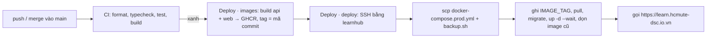

# Triển khai & vận hành Learning Hub

Tài liệu bàn giao cho tech lead hiện tại và các thế hệ sau: hệ thống production đang chạy thế nào, cài lại từ đầu ra sao, và những lỗi đã gặp.

> **Hai bản phải đi cùng nhau.** Runbook có lệnh chi tiết nằm cạnh code: [`learning-hub/deploy/README.md`](https://github.com/hcmute-dsc/learning-hub/blob/main/deploy/README.md). Khi đổi cách deploy, sửa runbook đó **và** tài liệu này trong cùng đợt. Mỗi lần hướng dẫn ai đó cài đặt, ghi các bước vào đây rồi commit.
>
> Không bao giờ ghi giá trị secret, mật khẩu, URL webhook hay IP thật của VPS vào repo. Chỉ ghi **tên** secret và **nơi** cất nó.

Cập nhật lần cuối: 17/11/2026.

## 1. Hiện trạng production

| Mục | Giá trị |
| --- | --- |
| Địa chỉ | https://learn.hcmute-dsc.io.vn |
| Máy chủ | 1 VPS Ubuntu 22.04 do Chủ nhiệm CLB đương nhiệm tài trợ, dùng chung với các site khác của CLB |
| Reverse proxy | Traefik v3 có sẵn trên VPS (container `traefik`, mạng Docker `edge`, entrypoint `websecure`, cert resolver `letsencrypt` qua Cloudflare DNS challenge) |
| DNS | bản ghi `learn` trên Cloudflare, **Proxied** (đám mây cam) → `TRUST_PROXY_HOPS=2` |
| Thư mục | `/opt/learning-hub` (chủ: user `learnhub`) chứa `.env`, `docker-compose.prod.yml`, `backup.sh`, `backups/` |
| Container | `db` (PostgreSQL 16, riêng của Learning Hub), `migrate` (chạy xong thì thoát), `api` (alias `learning-hub-api`), `web` (nằm trong mạng `edge`) |
| User deploy | `learnhub`: nhóm `docker`, **không** `sudo`, chỉ đăng nhập bằng SSH key |
| Deploy | tự động mỗi lần CI xanh trên `main` (workflow `Deploy`) |
| Sao lưu | cron của `learnhub` lúc 19:30 UTC (2:30 sáng giờ VN), giữ 14 ngày, thư mục `700`, file `600` |
| Giám sát | workflow `Uptime` mỗi 15 phút; cảnh báo lỗi 500 vào kênh Discord vận hành |
| Discord | bật 17/11/2026: kênh CLB + kênh vận hành riêng tư |

**Secret và biến trên GitHub** (repo `hcmute-dsc/learning-hub`):

| Tên | Loại | Dùng cho |
| --- | --- | --- |
| `VPS_HOST`, `VPS_USER`, `VPS_SSH_KEY`, `VPS_KNOWN_HOSTS` (`VPS_PORT` nếu không phải 22) | secret của environment `production` | workflow Deploy SSH vào VPS |
| `DISCORD_ALERT_WEBHOOK_URL` | secret của repo | workflow Uptime báo site sập |
| `DEPLOY_ENABLED` = `true` | biến của repo | bật bước SSH của Deploy (đặt `false` để tạm tắt) |

**Secret trên VPS** (chỉ trong `/opt/learning-hub/.env`, quyền `600`): `POSTGRES_PASSWORD` / `DATABASE_URL`, `GITHUB_CLIENT_ID` / `GITHUB_CLIENT_SECRET` (OAuth app production), `BOOTSTRAP_ADMIN_GITHUB_LOGIN`, `WEB_ORIGIN`, `TRUST_PROXY_HOPS`, `DISCORD_WEBHOOK_URL`, `DISCORD_ALERT_WEBHOOK_URL`, `IMAGE_TAG` (workflow tự ghi).

## 2. Luồng auto deploy



| Bước | Chi tiết |
| --- | --- |
| Khi nào chạy | sau khi CI xanh trên `main` (`workflow_run`), hoặc bấm tay **Actions → Deploy → Run workflow**. Hai lần deploy không chạy cùng lúc. |
| Build image | đẩy lên `ghcr.io/hcmute-dsc/learning-hub-{api,web}` với tag mã commit và `latest`, dùng `GITHUB_TOKEN` (không cần secret riêng). |
| SSH | khóa `VPS_SSH_KEY` và host key `VPS_KNOWN_HOSTS` được ghi ra file tạm. Host key được ghim, nên job từ chối máy không phải VPS của mình. |
| Copy file | ghi đè `docker-compose.prod.yml` và `backup.sh` trên VPS → **sửa 2 file này trong repo, không sửa trên VPS**. |
| Khởi động lại | đăng nhập GHCR bằng token chỉ sống trong job rồi đăng xuất ngay; ghi `IMAGE_TAG=<commit>` vào `.env`; `migrate` chạy trước `api`; xóa image Learning Hub cũ (lọc theo label, không đụng image site khác). |
| Kiểm tra | gọi trang chủ tối đa 10 lần, không trả lời thì job đỏ. |

## 3. Cài đặt từ đầu (VPS mới hoặc bàn giao)

`VPS_IP` dưới đây là chữ giữ chỗ, **thay bằng IP thật** trước khi chạy. IP thật không ghi trong repo nào: hỏi tech lead, hoặc xem bản ghi `learn` trên Cloudflare.

### 3.1. DNS và Docker
1. Cloudflare → zone `hcmute-dsc.io.vn` → thêm bản ghi `A`, name `learn`, trỏ `VPS_IP`, **Proxied**.
2. Trên VPS: `docker --version && docker compose version` (cần Compose ≥ 2.20). Chưa có thì `curl -fsSL https://get.docker.com | sudo sh`.
3. Kiểm tra mạng của Traefik: `docker network ls --filter name=^edge$` phải thấy `edge`.

### 3.2. Tạo user `learnhub` trên VPS
Chạy bằng user có `sudo` của bạn:

```bash
sudo adduser --disabled-password --gecos "" learnhub
sudo usermod -aG docker learnhub
sudo mkdir -p /opt/learning-hub/backups
sudo chown -R learnhub:learnhub /opt/learning-hub
id learnhub                 # phải có nhóm docker
```

Vì sao dùng user riêng: GitHub Actions không cần (và không nên có) `root` hay tài khoản cá nhân. Nhưng nhóm `docker` gần bằng root, nên user này chỉ dùng cho deploy và chỉ đăng nhập bằng key.

### 3.3. Tạo SSH key và đưa lên VPS
Trên **máy của bạn**, trong `~/.ssh` (không tạo trong thư mục repo nào, lỡ commit là lộ khóa), **không passphrase** vì GitHub Actions không gõ passphrase được:

```bash
cd ~/.ssh
ssh-keygen -t ed25519 -N "" -C "learning-hub-deploy" -f learning-hub-deploy
```

Trên Windows PowerShell: bỏ `-N ""` và bấm Enter 2 lần khi được hỏi passphrase (PowerShell biến `-N '""'` thành passphrase là 2 dấu ngoặc kép).

Đưa khóa công khai lên VPS:

```bash
# trên VPS
sudo -u learnhub mkdir -p /home/learnhub/.ssh
sudo -u learnhub nano /home/learnhub/.ssh/authorized_keys   # dán nội dung learning-hub-deploy.pub
sudo chmod 700 /home/learnhub/.ssh && sudo chmod 600 /home/learnhub/.ssh/authorized_keys
```

Kiểm tra từ máy bạn:

```bash
ssh -i ~/.ssh/learning-hub-deploy learnhub@VPS_IP "docker ps"
```

Tiện hơn: thêm vào `~/.ssh/config` để sau này chỉ gõ `ssh learnhub`:

```
Host learnhub
  HostName VPS_IP
  User learnhub
  IdentityFile ~/.ssh/learning-hub-deploy
  IdentitiesOnly yes
```

### 3.4. OAuth app và file `.env`
1. Tạo GitHub OAuth app **riêng cho production** (không dùng lại app localhost). Callback: `https://learn.hcmute-dsc.io.vn/api/v1/auth/github/callback`.
2. Tạo `/opt/learning-hub/.env` từ `deploy/.env.example` của repo code: mật khẩu DB bằng `openssl rand -hex 24` (thay cả 2 chỗ `change-me`), Client ID/secret, login GitHub của admin đầu tiên, `TRUST_PROXY_HOPS=2`.
3. `chmod 600 /opt/learning-hub/.env`.

Người cài tự điền giá trị trên VPS. Không gửi secret qua chat hay issue.

### 3.5. Secret GitHub Actions
Bằng `gh` CLI trên máy bạn (trong `~/.ssh`). Khóa đi thẳng từ file lên GitHub, không qua clipboard:

```bash
gh api -X PUT repos/hcmute-dsc/learning-hub/environments/production
gh secret set VPS_HOST --env production --repo hcmute-dsc/learning-hub --body "VPS_IP"
gh secret set VPS_USER --env production --repo hcmute-dsc/learning-hub --body "learnhub"
gh secret set VPS_SSH_KEY --env production --repo hcmute-dsc/learning-hub < learning-hub-deploy
ssh-keyscan -p 22 VPS_IP | gh secret set VPS_KNOWN_HOSTS --env production --repo hcmute-dsc/learning-hub
gh secret list --env production --repo hcmute-dsc/learning-hub
```

Hoặc trên web: repo → **Settings → Environments → production** → thêm từng secret.

### 3.6. Bật deploy và chạy lần đầu

```bash
gh variable set DEPLOY_ENABLED --repo hcmute-dsc/learning-hub --body true
gh workflow run deploy.yml --repo hcmute-dsc/learning-hub --ref main
gh run watch --repo hcmute-dsc/learning-hub
```

Kiểm tra trên VPS: `cd /opt/learning-hub && docker compose -f docker-compose.prod.yml ps`. Phải thấy `db`, `api`, `web` healthy, `migrate` exited (0).

Đưa nội dung lên: đăng nhập bằng GitHub của admin → **Quản trị → Nội dung → Đồng bộ → Publish**.

### 3.7. Sao lưu

```bash
sudo -u learnhub crontab -e
# thêm dòng:
30 19 * * * /opt/learning-hub/backup.sh >> /opt/learning-hub/backups/backup.log 2>&1
```

Chạy thử: `sudo -u learnhub /opt/learning-hub/backup.sh`. Bản sao lưu chứa email thành viên, chỉ `learnhub` đọc được. Nên định kỳ chép một bản về máy khác: hỏng VPS là mất cả dữ liệu lẫn bản sao lưu.

### 3.8. Discord
1. Trong Discord: chuột phải vào kênh → **Edit Channel → Integrations → Webhooks → New Webhook → Copy Webhook URL**. Làm cho 2 kênh: kênh CLB và kênh vận hành **riêng tư**.
2. SSH bằng `learnhub`, `nano /opt/learning-hub/.env`, điền `DISCORD_WEBHOOK_URL=` (kênh CLB) và `DISCORD_ALERT_WEBHOOK_URL=` (kênh vận hành).
3. `gh secret set DISCORD_ALERT_WEBHOOK_URL --repo hcmute-dsc/learning-hub`, rồi dán URL kênh vận hành khi được hỏi.
4. Chạy lại Deploy để API đọc `.env`.

Kiểm tra trên VPS (URL đọc từ `.env`, không hiện ra màn hình):

```bash
cd /opt/learning-hub
for k in DISCORD_WEBHOOK_URL DISCORD_ALERT_WEBHOOK_URL; do
  curl -fsS -H 'Content-Type: application/json' -d "{\"content\":\"Learning Hub: thử $k\"}" \
    "$(grep "^$k=" .env | cut -d= -f2-)" && echo "$k OK"
done
```

URL webhook lộ ra thì vào lại chỗ tạo, **Delete Webhook** rồi tạo cái mới.

## 4. Việc thường ngày

| Việc | Cách làm |
| --- | --- |
| Deploy phiên bản mới | merge vào `main` |
| Deploy lại sau khi sửa `.env` | `gh workflow run deploy.yml --repo hcmute-dsc/learning-hub --ref main` |
| Xem log | `ssh learnhub`, rồi `cd /opt/learning-hub && docker compose -f docker-compose.prod.yml logs -f api web` |
| Cập nhật nội dung | **Quản trị → Nội dung** |
| Quay về phiên bản cũ | revert commit lỗi trên `main` (migration không tự quay ngược: cần thì khôi phục DB từ bản sao lưu) |
| Tạm tắt auto deploy | `gh variable set DEPLOY_ENABLED --repo hcmute-dsc/learning-hub --body false` |

Lệnh khôi phục database và quay về image cũ bằng tay: xem runbook trong repo code.

## 5. Lỗi đã gặp khi cài (17/11/2026)

| Hiện tượng | Nguyên nhân | Cách sửa |
| --- | --- | --- |
| `Could not resolve hostname vps_ip` | quên thay chữ giữ chỗ | thay bằng IP thật |
| `Connection refused` khi SSH | dùng nhầm IP (không phải IP của VPS) hoặc sai cổng | lấy IP từ trang quản lý của nhà cung cấp VPS |
| `UNPROTECTED PRIVATE KEY FILE` (Windows) | file khóa cho người khác đọc; `icacls` cấp nhầm cho **máy** khi máy và user trùng tên | `icacls KEY /inheritance:r /grant:r "$(whoami):F"` |
| `ssh -v` báo `Server accepts key` rồi vẫn `Permission denied` | khóa có passphrase `""` do PowerShell | `ssh-keygen -p -f KEY -P '""' -N ''` (hoặc tạo lại khóa) |
| Khóa nằm trong thư mục repo website | chạy `ssh-keygen` sai thư mục | chuyển vào `~/.ssh`, kiểm tra không bị commit |
| `pull access denied` cho image `latest` | `.env` chưa có `IMAGE_TAG` | workflow giờ tự ghi `IMAGE_TAG` |
| Trang đăng nhập báo 500 | trên mạng `edge` dùng chung, tên `api` trỏ nhầm sang API của site khác | API dùng alias riêng `learning-hub-api` |
| Mọi người cùng bị "quá nhiều request" | trang server-render dùng chung IP của container web | web chuyển tiếp `X-Forwarded-For`, `TRUST_PROXY_HOPS=2` |
| Đĩa VPS đầy dần (~1 GB mỗi lần deploy) | image cũ còn tag nên `prune` thường không xóa | `prune -af` lọc theo label của repo |
| Crontab trống sau khi cài | lệnh cài cron chạy với `set -e` khi `crontab -l` còn rỗng | ghi crontab trực tiếp, kiểm tra bằng `crontab -l` |
| File sao lưu ai cũng đọc được | thiếu `umask` | `backup.sh` đặt `umask 077` |

Bảng lỗi đầy đủ (Traefik, HTTPS, OAuth, cookie, Discord): mục "Lỗi thường gặp" trong runbook.

## 6. Bàn giao cho tech lead mới

1. Người mới tạo **SSH key của riêng họ**. Thêm vào VPS (user cá nhân của họ để quản trị, và `learnhub` nếu cần). Không chia sẻ khóa cũ.
2. Chuyển quyền admin repo/org GitHub, quyền Cloudflare (DNS) và quyền quản trị VPS.
3. Chuyển OAuth app sang org hoặc tạo lại, rồi sửa `GITHUB_CLIENT_*` trong `.env` và chạy lại Deploy.
4. Tạo key deploy mới (mục 3.3, 3.5), xóa khóa cũ khỏi `authorized_keys`, cập nhật `VPS_SSH_KEY`.
5. Kiểm tra lại webhook Discord (mục 3.8). Người cũ rời server thì tạo webhook mới.
6. Cập nhật bảng "Hiện trạng production" ở mục 1 và ngày "Cập nhật lần cuối".
