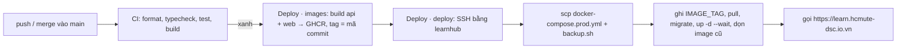

# Triển khai & vận hành Learning Hub

Tài liệu bàn giao cho tech lead hiện tại và các thế hệ sau: hệ thống production đang chạy thế nào, cài lại từ đầu ra sao, và những lỗi đã gặp.

> **Hai bản phải đi cùng nhau.** Runbook có lệnh chi tiết nằm cạnh code: [`learning-hub/deploy/README.md`](https://github.com/hcmute-dsc/learning-hub/blob/main/deploy/README.md). Khi đổi cách deploy, sửa runbook đó **và** tài liệu này trong cùng đợt. Mỗi lần hướng dẫn ai đó cài đặt, ghi các bước vào đây rồi commit.
>
> Không bao giờ ghi giá trị secret, mật khẩu, URL webhook hay IP thật của VPS vào repo. Chỉ ghi **tên** secret và **nơi** cất nó.

Cập nhật lần cuối: 18/11/2026.

## 1. Hiện trạng production

| Mục | Giá trị |
| --- | --- |
| Địa chỉ | https://learn.hcmute-dsc.io.vn |
| Máy chủ | 1 VPS Ubuntu 22.04 do Chủ nhiệm CLB đương nhiệm tài trợ, dùng chung với các site khác của CLB |
| Reverse proxy | Traefik v3 có sẵn trên VPS (container `traefik`, mạng Docker `edge`, entrypoint `websecure`, cert resolver `letsencrypt` qua Cloudflare DNS challenge) |
| DNS | bản ghi `learn` trên Cloudflare, **Proxied** (đám mây cam) → `TRUST_PROXY_HOPS=2` |
| Thư mục | `/opt/learning-hub` (chủ: user `learnhub`) chứa `.env`, `docker-compose.prod.yml`, `backup.sh`, `backups/` |
| Container | `db` (PostgreSQL 16, riêng của Learning Hub), `migrate` (chạy xong thì thoát), `api` (alias `learning-hub-api`), `web` (nằm trong mạng `edge`) |
| User deploy | `learnhub`: nhóm `docker`, **không** `sudo`, chỉ đăng nhập bằng SSH key |
| Deploy | tự động mỗi lần CI xanh trên `main` (workflow `Deploy`) |
| Sao lưu | cron của `learnhub` lúc 19:30 UTC (2:30 sáng giờ VN), giữ 14 ngày; kiểm tra khôi phục mỗi tháng (mục 5) |
| Bản sao ngoài VPS | chưa bật ([learning-hub#1](https://github.com/hcmute-dsc/learning-hub/issues/1)): mã hóa `age` mỗi tuần, kéo về máy tech lead (mục 5.2) |
| Giám sát | workflow `Uptime` mỗi 15 phút; cảnh báo lỗi 500 vào kênh Discord vận hành |
| Discord | bật 17/11/2026: kênh CLB + kênh vận hành riêng tư |
| Email tóm tắt (SMTP) | chưa bật: `SMTP_*` trong `.env` còn trống (mục 3.9) |
| Kết nối Discord + bảng xếp hạng tuần | bật 21/11/2026 (Discord application "HCMUTE DSC Learning Hub", mục 3.10); bài tuần đăng sáng thứ Hai 9:00 qua webhook kênh CLB |

**Secret và biến trên GitHub** (repo `hcmute-dsc/learning-hub`):

| Tên | Loại | Dùng cho |
| --- | --- | --- |
| `VPS_HOST`, `VPS_USER`, `VPS_SSH_KEY`, `VPS_KNOWN_HOSTS` (`VPS_PORT` nếu không phải 22) | secret của environment `production` | workflow Deploy SSH vào VPS |
| `DISCORD_ALERT_WEBHOOK_URL` | secret của repo | workflow Uptime báo site sập |
| `DEPLOY_ENABLED` = `true` | biến của repo | bật bước SSH của Deploy (đặt `false` để tạm tắt) |

**Secret trên VPS** (chỉ trong `/opt/learning-hub/.env`, quyền `600`): `POSTGRES_PASSWORD` / `DATABASE_URL`, `GITHUB_CLIENT_ID` / `GITHUB_CLIENT_SECRET` (OAuth app production), `BOOTSTRAP_ADMIN_GITHUB_LOGIN`, `WEB_ORIGIN`, `TRUST_PROXY_HOPS`, `DISCORD_WEBHOOK_URL`, `DISCORD_ALERT_WEBHOOK_URL`, `SMTP_PASSWORD` (cùng `SMTP_HOST`, `SMTP_PORT`, `SMTP_USER`, `SMTP_FROM`; tuỳ chọn), `IMAGE_TAG` (workflow tự ghi).

## 2. Luồng auto deploy



| Bước | Chi tiết |
| --- | --- |
| Khi nào chạy | sau khi CI xanh trên `main` (`workflow_run`), hoặc bấm tay **Actions → Deploy → Run workflow**. Hai lần deploy không chạy cùng lúc. |
| Build image | đẩy lên `ghcr.io/hcmute-dsc/learning-hub-{api,web}` với tag mã commit và `latest`, dùng `GITHUB_TOKEN` (không cần secret riêng). |
| SSH | khóa `VPS_SSH_KEY` và host key `VPS_KNOWN_HOSTS` được ghi ra file tạm. Host key được ghim, nên job từ chối máy không phải VPS của mình. |
| Copy file | ghi đè `docker-compose.prod.yml` và `backup.sh` trên VPS → **sửa 2 file này trong repo, không sửa trên VPS**. |
| Khởi động lại | đăng nhập GHCR bằng token chỉ sống trong job rồi đăng xuất ngay; ghi `IMAGE_TAG=<commit>` vào `.env`; `migrate` chạy trước `api`; xóa image Learning Hub cũ (lọc theo label, không đụng image site khác). |
| Kiểm tra | gọi trang chủ tối đa 10 lần, không trả lời thì job đỏ. |

## 3. Cài đặt từ đầu (VPS mới hoặc bàn giao)

`VPS_IP` dưới đây là chữ giữ chỗ, **thay bằng IP thật** trước khi chạy. IP thật không ghi trong repo nào: hỏi tech lead, hoặc xem bản ghi `learn` trên Cloudflare.

### 3.1. DNS và Docker
1. Cloudflare → zone `hcmute-dsc.io.vn` → thêm bản ghi `A`, name `learn`, trỏ `VPS_IP`, **Proxied**.
2. Trên VPS: `docker --version && docker compose version` (cần Compose ≥ 2.20). Chưa có thì `curl -fsSL https://get.docker.com | sudo sh`.
3. Kiểm tra mạng của Traefik: `docker network ls --filter name=^edge$` phải thấy `edge`.

### 3.2. Tạo user `learnhub` trên VPS
Chạy bằng user có `sudo` của bạn:

```bash
sudo adduser --disabled-password --gecos "" learnhub
sudo usermod -aG docker learnhub
sudo mkdir -p /opt/learning-hub/backups
sudo chown -R learnhub:learnhub /opt/learning-hub
id learnhub                 # phải có nhóm docker
```

Vì sao dùng user riêng: GitHub Actions không cần (và không nên có) `root` hay tài khoản cá nhân. Nhưng nhóm `docker` gần bằng root, nên user này chỉ dùng cho deploy và chỉ đăng nhập bằng key.

### 3.3. Tạo SSH key và đưa lên VPS
Trên **máy của bạn**, trong `~/.ssh` (không tạo trong thư mục repo nào, lỡ commit là lộ khóa), **không passphrase** vì GitHub Actions không gõ passphrase được:

```bash
cd ~/.ssh
ssh-keygen -t ed25519 -N "" -C "learning-hub-deploy" -f learning-hub-deploy
```

Trên Windows PowerShell: bỏ `-N ""` và bấm Enter 2 lần khi được hỏi passphrase (PowerShell biến `-N '""'` thành passphrase là 2 dấu ngoặc kép).

Đưa khóa công khai lên VPS:

```bash
# trên VPS
sudo -u learnhub mkdir -p /home/learnhub/.ssh
sudo -u learnhub nano /home/learnhub/.ssh/authorized_keys   # dán nội dung learning-hub-deploy.pub
sudo chmod 700 /home/learnhub/.ssh && sudo chmod 600 /home/learnhub/.ssh/authorized_keys
```

Kiểm tra từ máy bạn:

```bash
ssh -i ~/.ssh/learning-hub-deploy learnhub@VPS_IP "docker ps"
```

Tiện hơn: thêm vào `~/.ssh/config` để sau này chỉ gõ `ssh learnhub`:

```
Host learnhub
  HostName VPS_IP
  User learnhub
  IdentityFile ~/.ssh/learning-hub-deploy
  IdentitiesOnly yes
```

### 3.4. OAuth app và file `.env`
1. Tạo GitHub OAuth app **riêng cho production** (không dùng lại app localhost). Callback: `https://learn.hcmute-dsc.io.vn/api/v1/auth/github/callback`.
2. Tạo `/opt/learning-hub/.env` từ `deploy/.env.example` của repo code: mật khẩu DB bằng `openssl rand -hex 24` (thay cả 2 chỗ `change-me`), Client ID/secret, login GitHub của admin đầu tiên, `TRUST_PROXY_HOPS=2`.
3. `chmod 600 /opt/learning-hub/.env`.

Người cài tự điền giá trị trên VPS. Không gửi secret qua chat hay issue.

**Lời giải tham khảo (không bắt buộc, learning-hub#46).** Mặc định tắt (`SOLUTIONS_SOURCE=none`). Muốn bật: tạo fine-grained token chỉ đọc (Contents: Read-only) cho đúng repo riêng tư `learning-hub-checker`; trong `.env` đặt `SOLUTIONS_SOURCE=github`, `SOLUTIONS_REPO=hcmute-dsc/learning-hub-checker`, `SOLUTIONS_BRANCH=main` và tự gõ token vào `SOLUTIONS_GITHUB_TOKEN`; chạy lại Deploy rồi sync + publish nội dung. Lời giải được đọc ở commit mới nhất của repo checker lúc sync/publish; chỉ sửa lời giải thì phải đợi lần publish nội dung kế tiếp. Chi tiết: `deploy/README.md` bước 10 của repo code.

### 3.5. Secret GitHub Actions
Bằng `gh` CLI trên máy bạn (trong `~/.ssh`). Khóa đi thẳng từ file lên GitHub, không qua clipboard:

```bash
gh api -X PUT repos/hcmute-dsc/learning-hub/environments/production
gh secret set VPS_HOST --env production --repo hcmute-dsc/learning-hub --body "VPS_IP"
gh secret set VPS_USER --env production --repo hcmute-dsc/learning-hub --body "learnhub"
gh secret set VPS_SSH_KEY --env production --repo hcmute-dsc/learning-hub < learning-hub-deploy
ssh-keyscan -p 22 VPS_IP | gh secret set VPS_KNOWN_HOSTS --env production --repo hcmute-dsc/learning-hub
gh secret list --env production --repo hcmute-dsc/learning-hub
```

Hoặc trên web: repo → **Settings → Environments → production** → thêm từng secret.

### 3.6. Bật deploy và chạy lần đầu

```bash
gh variable set DEPLOY_ENABLED --repo hcmute-dsc/learning-hub --body true
gh workflow run deploy.yml --repo hcmute-dsc/learning-hub --ref main
gh run watch --repo hcmute-dsc/learning-hub
```

Kiểm tra trên VPS: `cd /opt/learning-hub && docker compose -f docker-compose.prod.yml ps`. Phải thấy `db`, `api`, `web` healthy, `migrate` exited (0).

Đưa nội dung lên: đăng nhập bằng GitHub của admin → **Quản trị → Nội dung → Đồng bộ → Publish**.

### 3.7. Sao lưu

```bash
sudo -u learnhub crontab -e
# thêm dòng:
30 19 * * * /opt/learning-hub/backup.sh >> /opt/learning-hub/backups/backup.log 2>&1
```

Chạy thử: `sudo -u learnhub /opt/learning-hub/backup.sh`. Kiểm tra: `sudo -u learnhub crontab -l` phải thấy dòng `backup.sh`. Bản sao lưu chứa email thành viên, nên chỉ `learnhub` đọc được. Xem, kiểm tra và khôi phục: [mục 5](#5-sao-lưu-và-khôi-phục-database). Bản sao mã hóa ra ngoài VPS mỗi tuần: [mục 5.2](#52-chép-ra-ngoài-vps-mỗi-tuần-tự-động).

### 3.8. Discord
1. Trong Discord: chuột phải vào kênh → **Edit Channel → Integrations → Webhooks → New Webhook → Copy Webhook URL**. Làm cho 2 kênh: kênh CLB và kênh vận hành **riêng tư**.
2. SSH bằng `learnhub`, `nano /opt/learning-hub/.env`, điền `DISCORD_WEBHOOK_URL=` (kênh CLB) và `DISCORD_ALERT_WEBHOOK_URL=` (kênh vận hành).
3. `gh secret set DISCORD_ALERT_WEBHOOK_URL --repo hcmute-dsc/learning-hub`, rồi dán URL kênh vận hành khi được hỏi.
4. Chạy lại Deploy để API đọc `.env`.

Kiểm tra trên VPS (URL đọc từ `.env`, không hiện ra màn hình):

```bash
cd /opt/learning-hub
for k in DISCORD_WEBHOOK_URL DISCORD_ALERT_WEBHOOK_URL; do
  curl -fsS -H 'Content-Type: application/json' -d "{\"content\":\"Learning Hub: thử $k\"}" \
    "$(grep "^$k=" .env | cut -d= -f2-)" && echo "$k OK"
done
```

URL webhook lộ ra thì vào lại chỗ tạo, **Delete Webhook** rồi tạo cái mới.

### 3.9. Email tóm tắt qua SMTP (không bắt buộc)
Chuông thông báo luôn chạy. Email tóm tắt hằng ngày chỉ gửi khi có SMTP **và** thành viên tự bật trong `/settings` (mặc định tắt). Thiếu `SMTP_HOST` hoặc `SMTP_FROM` thì không gửi gì, công tắc bị khoá kèm lời giải thích. Chi tiết đầy đủ: `deploy/README.md` Bước 13.

1. Chọn tài khoản gửi của CLB (không dùng email cá nhân):
   - Gmail/Google Workspace của CLB: `SMTP_HOST=smtp.gmail.com`, `SMTP_PORT=465`, `SMTP_USER` = địa chỉ Gmail, `SMTP_PASSWORD` = **App password** (cần bật xác minh 2 bước), `SMTP_FROM` = `DSC Learning Hub <chính địa chỉ đó>`. Khoảng 500 email/ngày.
   - Hoặc dịch vụ gửi email (Brevo, Resend, Mailgun, SES…): host/cổng `587`/login/key theo trang SMTP của dịch vụ; xác minh tên miền gửi (SPF/DKIM) theo hướng dẫn của họ.
2. SSH bằng `learnhub`, `nano /opt/learning-hub/.env`, điền 5 dòng `SMTP_*` (mẫu ở `deploy/.env.example`). Không dán mật khẩu vào chat, issue hay PR.
3. Chạy lại Deploy để API đọc `.env`.
4. Kiểm tra (gửi 1 email thử, không in mật khẩu):

```bash
cd /opt/learning-hub
docker compose -f docker-compose.prod.yml exec -T api node dist/cli/smtp-check.js email-cua-ban@example.org
```

`SMTP OK` và email tới hộp thư (xem cả Spam) là xong; `SMTP is off` = thiếu biến hoặc chưa Deploy lại; `SMTP FAILED: …` = đọc câu lỗi (535 sai mật khẩu, timeout cổng bị chặn, 553 sai người gửi). Cổng `25` thường bị VPS chặn, đừng dùng.

Gỡ lỗi: thông báo và email đi qua bảng `outbox_events` (DATABASE §3.16f), thử lại tối đa 8 lần:

```bash
docker compose -f docker-compose.prod.yml exec -T db psql -U hub -d learning_hub -c \
  "select id, type, status, attempts, last_error, created_at from outbox_events where status <> 'sent' order by id desc limit 20"
```

Mật khẩu SMTP lộ: thu hồi App password/SMTP key, tạo cái mới, sửa `.env`, Deploy lại.

### 3.10. Kết nối Discord và bảng xếp hạng tuần (không bắt buộc)
Thành viên bấm **Kết nối Discord** trong `/settings` (OAuth2, chỉ scope `identify`: đọc id và tên Discord, không đọc tin nhắn hay server). Sáng thứ Hai 9:00 giờ VN, API đăng top 5 bảng xếp hạng tuần trước lên **kênh CLB** qua `DISCORD_WEBHOOK_URL` (mục 3.8) và tag người đã kết nối ([learning-hub#76](https://github.com/hcmute-dsc/learning-hub/issues/76), [ADR-08](../product/DECISIONS.md#adr-08--loại-khỏi-mvp)). Không cần bot. Chỉ người đã bật bảng xếp hạng mới có tên; kết nối Discord không phải đồng ý lên bảng. Chi tiết đầy đủ: `deploy/README.md` Bước 14.

1. https://discord.com/developers/applications → **New Application** (`DSC Learning Hub`).
2. Tab **OAuth2 → Redirects → Add Redirect**: `https://learn.hcmute-dsc.io.vn/api/v1/me/discord/callback`, **Save Changes**. Local dùng application riêng với `http://localhost:3000/api/v1/me/discord/callback`.
3. Cũng tab **OAuth2**: chép **Client ID**, bấm **Reset Secret** lấy **Client Secret** (chỉ hiện một lần). Không cần bot, không mời app vào server.
4. SSH bằng `learnhub`, `nano /opt/learning-hub/.env`, điền `DISCORD_CLIENT_ID=` và `DISCORD_CLIENT_SECRET=`. Không commit, không dán vào chat, issue hay PR.
5. Chạy lại Deploy để API đọc `.env`.

Thiếu hai biến này thì nút bị ẩn, bài tuần vẫn đăng (mọi người hiện bằng tên). Thiếu `DISCORD_WEBHOOK_URL` thì không đăng gì.

Kiểm tra: vào `/settings` → mục **Discord** → **Kết nối Discord** → quay về thấy tên Discord; **Quản trị → Nhật ký** có dòng "Kết nối Discord". Sau 9:00 thứ Hai:

```bash
docker compose -f docker-compose.prod.yml exec -T db psql -U hub -d learning_hub -c   "select id, idempotency_key, status, attempts, last_error from outbox_events where type = 'discord.leaderboard_week' order by id desc limit 5"
```

Mỗi tuần có đúng một dòng `leaderboard-week:<YYYY-Www>`; chạy lại trong tuần không tạo dòng mới. Tuần không ai có bài thì không có dòng. Client Secret lộ: **Reset Secret** trên Discord, sửa `.env`, Deploy lại.

## 4. Việc thường ngày

| Việc | Cách làm |
| --- | --- |
| Deploy phiên bản mới | merge vào `main` |
| Deploy lại sau khi sửa `.env` | `gh workflow run deploy.yml --repo hcmute-dsc/learning-hub --ref main` |
| Xem log | `ssh learnhub`, rồi `cd /opt/learning-hub && docker compose -f docker-compose.prod.yml logs -f api web` |
| Cập nhật nội dung | **Quản trị → Nội dung** |
| Quay về phiên bản cũ | revert commit lỗi trên `main` (migration không tự quay ngược: cần thì khôi phục DB từ bản sao lưu) |
| Tạm tắt auto deploy | `gh variable set DEPLOY_ENABLED --repo hcmute-dsc/learning-hub --body false` |

Lệnh quay về image cũ bằng tay: xem runbook trong repo code.

## 5. Sao lưu và khôi phục database

Mọi lệnh chạy trên VPS bằng `learnhub` (`ssh learnhub`), trong `/opt/learning-hub`.

### 5.1. Cơ chế

| | |
| --- | --- |
| Script | `backup.sh` (trong repo code `deploy/`, workflow Deploy chép lên VPS) |
| Lịch | cron của `learnhub`, 19:30 UTC = 2:30 sáng giờ VN |
| Cách làm | `pg_dump` database `learning_hub` (SQL, không kèm owner) → nén gzip → `backups/learning_hub-YYYYMMDD-HHMMSS.sql.gz` |
| Giữ | 14 ngày (biến `KEEP_DAYS`), file cũ hơn tự xóa |
| Quyền | thư mục `700`, file `600`: chỉ `learnhub` đọc được, vì có email thành viên |
| Dung lượng | khoảng 360 KB/bản (17/11/2026). Đĩa VPS còn nhiều, nhưng nên xem lại khi số thành viên tăng mạnh |

**Có trong bản sao lưu:** tài khoản và email, bài nộp, review, phiên bản nội dung, nhật ký quản trị.
**Không có:**
- `.env` (secret): giữ riêng, mất thì tạo lại.
- Bài học gốc: nằm trên GitHub.

| Việc | Lệnh |
| --- | --- |
| Xem các bản sao lưu | `ls -lh backups/` |
| Cron có chạy không | `tail backups/backup.log` (mỗi đêm một dòng `backup ok`) |
| Sao lưu ngay | `./backup.sh`, chạy trước mọi thao tác nguy hiểm với DB |

### 5.2. Chép ra ngoài VPS (mỗi tuần, tự động)

Hỏng VPS là mất cả dữ liệu lẫn bản sao lưu trên đó, nên mỗi tuần có một bản **mã hóa** được kéo về máy tech lead. Đã so sánh 3 nơi giữ (máy tech lead, bucket cloud riêng, Google Drive CLB) và chọn máy tech lead: không thêm tài khoản, không thêm secret trên VPS ([learning-hub#1](https://github.com/hcmute-dsc/learning-hub/issues/1)).

| | |
| --- | --- |
| Mã hóa | `offsite-export.sh`, cron `learnhub` Chủ nhật 20:00 UTC (3:00 sáng thứ Hai giờ VN): bản sao lưu mới nhất → `age` với khóa **công khai** trong `/opt/learning-hub/offsite-recipients.txt` → `backups/offsite/learning_hub-….sql.gz.age`, giữ 4 bản. Từ chối nếu bản mới nhất cũ hơn 2 ngày hoặc hỏng gzip |
| Kéo về | `offsite-pull.ps1` trên máy tech lead (Windows Task Scheduler, thứ Hai 9:00, chạy bù nếu máy tắt): tải bản mới, giữ 12 bản (~3 tháng), ghi `pull.log` |
| Quyền | SSH key riêng `learning-hub-backup-pull`, bị khóa bằng `restrict,command="/opt/learning-hub/offsite-serve.sh"`: chỉ `list` và `get <file .age>`. Không mở shell, không đọc được `.env` hay bản chưa mã hóa |
| Giải mã | chỉ khóa bí mật `age` (có passphrase) trên máy tech lead. VPS không có khóa này. Khóa và passphrase cất trong trình quản lý mật khẩu: mất là mọi bản sao ngoài VPS vô dụng |
| Nơi để | thư mục **ngoài mọi repo git** (vd. `$HOME\learning-hub-backups`, `D:\repos\learning-hub-backups`); script tự từ chối thư mục trong repo |

Cài đặt một lần (lệnh đầy đủ ở [`deploy/README.md`, "Chép bản sao lưu ra ngoài VPS"](https://github.com/hcmute-dsc/learning-hub/blob/main/deploy/README.md#chép-bản-sao-lưu-ra-ngoài-vps-mỗi-tuần-tự-động)):

1. Máy tech lead: `winget install --id FiloSottile.age -e`; tạo khóa `age-keygen`, bọc passphrase bằng `age -p` thành `$HOME\.age\learning-hub-backup.key`; tạo SSH key `learning-hub-backup-pull` (không passphrase); thêm `Host learnhub-backup` vào `~/.ssh/config`.
2. VPS (sau khi Deploy đã chép script lên): `sudo apt install -y age`; dán dòng `age1…` vào `offsite-recipients.txt`; thêm dòng `restrict,command="/opt/learning-hub/offsite-serve.sh" <khóa .pub>` vào `authorized_keys` của `learnhub`; thêm cron `0 20 * * 0 /opt/learning-hub/offsite-export.sh >> /opt/learning-hub/backups/offsite.log 2>&1`; chạy thử một lần.
3. Máy tech lead: `ssh learnhub-backup list` (lưu host key), kiểm tra `ssh learnhub-backup "cat /opt/learning-hub/.env"` bị từ chối, chạy `offsite-pull.ps1` một lần, rồi `Register-ScheduledTask` theo README.

| Việc | Cách làm |
| --- | --- |
| Xem có chạy không | VPS: `tail backups/offsite.log` (mỗi tuần `offsite ok`). Máy tech lead: `pull.log` (mỗi tuần `pull ok`) |
| Khôi phục khi mất VPS | `age -d -i $HOME\.age\learning-hub-backup.key -o restore.sql.gz <file .age>` → `scp` lên VPS mới → mục 5.4, 5.5. Xóa file giải mã ngay sau đó |
| Thêm người giữ bản sao | thêm dòng `age1…` của họ vào `offsite-recipients.txt` |

### 5.3. Kiểm tra bản sao lưu (mỗi tháng)

Nạp bản mới nhất vào một Postgres **tạm, không nối mạng**, rồi so số dòng với production. Không đụng database thật:

```bash
cd /opt/learning-hub
f=$(ls -t backups/learning_hub-*.sql.gz | head -1); echo "Kiểm tra $f"
gunzip -t "$f" && echo "gzip OK"
docker run -d --rm --name lh-restore-test --network none \
  -e POSTGRES_PASSWORD=test -e POSTGRES_USER=hub -e POSTGRES_DB=learning_hub postgres:16
sleep 10
gunzip -c "$f" | docker exec -i lh-restore-test psql -q -v ON_ERROR_STOP=1 -U hub -d learning_hub >/dev/null && echo "Khôi phục OK"
Q="select (select count(*) from users), (select count(*) from submissions), (select count(*) from _prisma_migrations)"
docker exec lh-restore-test psql -U hub -d learning_hub -At -c "$Q"
docker compose -f docker-compose.prod.yml exec -T db psql -U hub -d learning_hub -At -c "$Q"
docker rm -f lh-restore-test
```

Kết quả đúng: thấy `Khôi phục OK`, và 2 dòng số gần bằng nhau (production có thể hơn một chút).

**Bản sao ngoài VPS** (mục 5.2) cũng kiểm tra mỗi tháng, trên máy tech lead (cần `age` và Docker Desktop). Script giải mã bản mới nhất vào thư mục tạm, nạp vào Postgres tạm `--network none`, so số dòng với production (chỉ đọc), rồi xóa container và file giải mã:

```powershell
powershell -NoProfile -ExecutionPolicy Bypass -File deploy\offsite-restore-check.ps1 `
  -Dest D:\repos\learning-hub-backups -ProdHost learnhub
```

Kết quả đúng: `Decrypt OK`, `gzip OK`, `Restore OK`, 2 dòng số gần bằng nhau. Dòng cuối in sẵn một hàng cho bảng dưới.

| Ngày | Kết quả |
| --- | --- |
| 17/11/2026 | bản `learning_hub-20261117-163728`: khôi phục OK, khớp production (3 tài khoản, 7 migration) |

Thêm một dòng vào bảng này mỗi lần kiểm tra.

### 5.4. Khôi phục production

Mọi dữ liệu **sau** thời điểm sao lưu sẽ mất. Báo trước trên Discord CLB, vì site tắt vài phút.

```bash
cd /opt/learning-hub
ls -lh backups/                                                  # 1. chọn file
./backup.sh                                                      # 2. sao lưu hiện trạng, phòng khi chọn nhầm
docker compose -f docker-compose.prod.yml stop web api           # 3. tắt site
docker compose -f docker-compose.prod.yml exec -T db psql -U hub -d postgres \
  -c "DROP DATABASE learning_hub WITH (FORCE);" -c "CREATE DATABASE learning_hub OWNER hub;"   # 4. làm rỗng DB
gunzip -c backups/learning_hub-YYYYMMDD-HHMMSS.sql.gz | \
  docker compose -f docker-compose.prod.yml exec -T db psql -q -v ON_ERROR_STOP=1 -U hub -d learning_hub   # 5. nạp lại
docker compose -f docker-compose.prod.yml up -d --wait           # 6. bật lại, migrate chạy trước api
docker compose -f docker-compose.prod.yml ps                     # 7. kiểm tra
```

- Bước 5 lỗi thì **đừng bật site**: làm lại từ bước 4 với file khác.
- Bản sao lưu cũ hơn code đang chạy: ở bước 6, `migrate` tự áp các migration còn thiếu.
- Khôi phục vì một bản deploy làm hỏng DB: quay `IMAGE_TAG` về bản cũ **trước**, nếu không migration lỗi sẽ chạy lại.
- Xong thì đăng nhập, xem **Quản trị → Thành viên** đủ tài khoản, rồi ghi sự cố vào [mục 7](#7-nhật-ký-sự-cố).

### 5.5. Chuyển sang VPS mới

1. Làm mục 3 trên VPS mới đến khi Deploy xanh.
2. `scp learning_hub-….sql.gz learnhub@VPS_MỚI:/opt/learning-hub/backups/`.
3. Khôi phục theo mục 5.4, từ bước 3.
4. Đổi bản ghi DNS `learn` sang IP mới, cập nhật secret `VPS_HOST` và `VPS_KNOWN_HOSTS`.

## 6. Lỗi đã gặp khi cài (17/11/2026)

| Hiện tượng | Nguyên nhân | Cách sửa |
| --- | --- | --- |
| `Could not resolve hostname vps_ip` | quên thay chữ giữ chỗ | thay bằng IP thật |
| `Connection refused` khi SSH | dùng nhầm IP (không phải IP của VPS) hoặc sai cổng | lấy IP từ trang quản lý của nhà cung cấp VPS |
| `UNPROTECTED PRIVATE KEY FILE` (Windows) | file khóa cho người khác đọc; `icacls` cấp nhầm cho **máy** khi máy và user trùng tên | `icacls KEY /inheritance:r /grant:r "$(whoami):F"` |
| `ssh -v` báo `Server accepts key` rồi vẫn `Permission denied` | khóa có passphrase `""` do PowerShell | `ssh-keygen -p -f KEY -P '""' -N ''` (hoặc tạo lại khóa) |
| Khóa nằm trong thư mục repo website | chạy `ssh-keygen` sai thư mục | chuyển vào `~/.ssh`, kiểm tra không bị commit |
| `pull access denied` cho image `latest` | `.env` chưa có `IMAGE_TAG` | workflow giờ tự ghi `IMAGE_TAG` |
| Trang đăng nhập báo 500 | trên mạng `edge` dùng chung, tên `api` trỏ nhầm sang API của site khác | API dùng alias riêng `learning-hub-api` |
| Mọi người cùng bị "quá nhiều request" | trang server-render dùng chung IP của container web | web chuyển tiếp `X-Forwarded-For`, `TRUST_PROXY_HOPS=2` |
| Deploy đỏ: `ssh: connect to host … port 22: Connection timed out` (19/11/2026, 2 lần) | kết nối runner GitHub → VPS đôi khi timeout một lần; site không bị gián đoạn | bước "Wait for SSH" thử lại tới 6 vòng, `scp` thử lại 3 lần, `ConnectTimeout 20` + `ConnectionAttempts 3` (learning-hub#63) |
| Đĩa VPS đầy dần (~1 GB mỗi lần deploy) | image cũ còn tag nên `prune` thường không xóa | `prune -af` lọc theo label của repo |
| Crontab trống sau khi cài | lệnh cài cron chạy với `set -e` khi `crontab -l` còn rỗng | ghi crontab trực tiếp, kiểm tra bằng `crontab -l` |
| File sao lưu ai cũng đọc được | thiếu `umask` | `backup.sh` đặt `umask 077` |

Bảng lỗi đầy đủ (Traefik, HTTPS, OAuth, cookie, Discord): mục "Lỗi thường gặp" trong runbook.

## 7. Nhật ký sự cố

Mỗi lần khôi phục database, quay về bản cũ hay site sập lâu, ghi một dòng ở đây.

| Ngày | Chuyện gì | Đã làm gì | Mất dữ liệu? |
| --- | --- | --- | --- |
| — | chưa có sự cố | | |

## 8. Bàn giao cho tech lead mới

0. Người mới cài và đăng nhập `gh` bằng tài khoản của họ: [GH-CLI.md](GH-CLI.md).
1. Người mới tạo **SSH key của riêng họ**. Thêm vào VPS (user cá nhân của họ để quản trị, và `learnhub` nếu cần). Không chia sẻ khóa cũ.
2. Chuyển quyền admin repo/org GitHub, quyền Cloudflare (DNS) và quyền quản trị VPS.
3. Chuyển OAuth app sang org hoặc tạo lại, rồi sửa `GITHUB_CLIENT_*` trong `.env` và chạy lại Deploy.
4. Tạo key deploy mới (mục 3.3, 3.5), xóa khóa cũ khỏi `authorized_keys`, cập nhật `VPS_SSH_KEY`.
5. Kiểm tra lại webhook Discord (mục 3.8). Người cũ rời server thì tạo webhook mới. Nếu đã bật email tóm tắt (mục 3.9): đổi App password/SMTP key của tài khoản gửi và sửa `SMTP_PASSWORD`. Nếu đã bật kết nối Discord (mục 3.10): chuyển quyền Discord application (Developer Portal → Team) hoặc **Reset Secret** và sửa `DISCORD_CLIENT_SECRET`.
6. Người mới làm phần cài đặt ở mục 5.2 với khóa `age` và SSH key của **họ**, thay dòng `age1…` trong `offsite-recipients.txt`, rồi tự chạy cả hai kiểm tra ở mục 5.3 một lần. Người cũ xóa dòng `learning-hub-backup-pull` của mình trong `authorized_keys`, gỡ task trong Task Scheduler, xóa các bản sao và khóa `age` trên máy mình.
7. GitHub App `hcmute-dsc-learning-hub` (tự thêm issue/PR vào project) thuộc org, không cần tạo lại. Chỉ cần người mới là owner của org; nghi lộ private key thì đổi key theo [WORKFLOW §4](WORKFLOW.md#4-cài-đặt-làm-bằng-tay-trên-web-api-của-github-chưa-hỗ-trợ).
8. Cập nhật bảng "Hiện trạng production" ở mục 1 và ngày "Cập nhật lần cuối".
