# Kiến trúc đang chạy: tài liệu bàn giao kỹ thuật

> Dành cho người mới nhận Learning Hub. Mỗi mục có một sơ đồ và vài dòng giải thích.
> Đối chiếu với code `hcmute-dsc/learning-hub@7a5ee54` và production ngày 19/11/2026.
> Thiết kế đầy đủ (gồm phần chưa làm): [ARCHITECTURE](../product/ARCHITECTURE.md).
> Cách vận hành: [DEPLOYMENT](DEPLOYMENT.md). Quy trình làm việc: [WORKFLOW](WORKFLOW.md).

Khi code đổi làm sơ đồ sai, sửa sơ đồ trong cùng PR, rồi cập nhật commit ở dòng đầu.

## Đọc theo thứ tự nào

1. §1 và §2: hệ thống gồm những gì, chạy ở đâu.
2. §3: code backend chia module ra sao.
3. §4 đến §6: ba luồng chính (đăng nhập, publish nội dung, nộp bài và review).
4. §7 và §8: code đi từ PR lên production thế nào, dữ liệu được sao lưu ra sao.
5. §9: trạng thái của bài nộp và phiên bản nội dung.
6. §10: những gì đang làm dở và chỗ sơ đồ sẽ phải sửa.

## 1. Bản đồ repo và dịch vụ

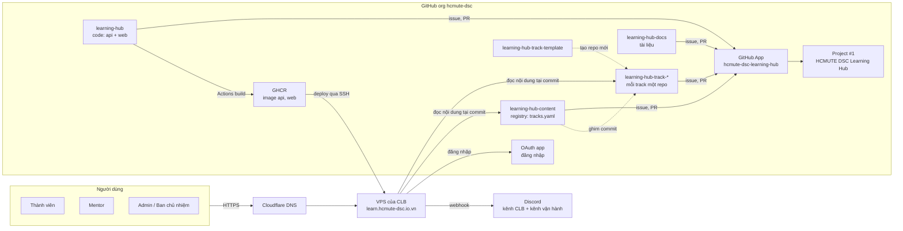

| Thành phần | Vai trò | Ghi chú |
| --- | --- | --- |
| `learning-hub` | Monorepo pnpm: `apps/api` (NestJS), `apps/web` (Next.js), `packages/content` (validator), `packages/shared` | Deploy tự động khi merge vào `main` |
| `learning-hub-content` | Registry: `tracks.yaml` ghim `{slug, repo, commit}` của từng track (ADR-10) | CI `validate` kiểm tra mọi track |
| `learning-hub-track-<slug>` | Bài học (Markdown) và bài tập (YAML) của một track | Tạo từ template bằng skill `new-track` ([NEW-TRACK](NEW-TRACK.md)) |
| GitHub App | Thêm issue và PR của mọi repo vào Project #1 | Biến `PROJECT_APP_CLIENT_ID` và secret `PROJECT_APP_PRIVATE_KEY` đặt ở cấp org ([WORKFLOW §4](WORKFLOW.md)) |
| OAuth app | Đăng nhập GitHub cho site | Client ID và secret nằm trong `.env` trên VPS |
| Discord | Webhook kênh CLB (`DISCORD_WEBHOOK_URL`) và kênh vận hành (`DISCORD_ALERT_WEBHOOK_URL`) | Chỉ gửi một chiều |

## 2. Các container trên VPS

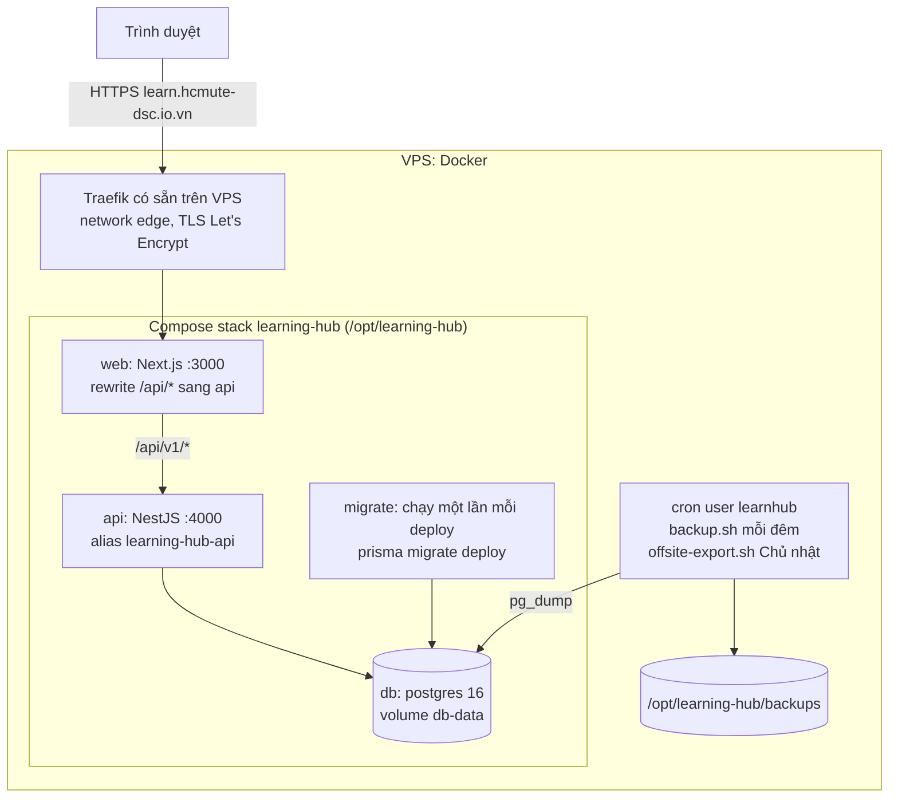

- Chỉ container `web` nối vào network `edge` của Traefik. `api` và `db` chỉ nằm trong network riêng của stack, nên các site khác trên VPS không gọi tới được.
- Trình duyệt chỉ nói chuyện với `web`. Next.js chuyển mọi đường dẫn `/api/*` sang `http://learning-hub-api:4000`; địa chỉ này được ghi cứng lúc build image (`API_INTERNAL_URL`).
- Thứ tự khởi động: `db` khỏe → `migrate` chạy xong → `api` khỏe → `web`. Migration lỗi thì deploy dừng, container cũ vẫn chạy.
- Secret chỉ nằm trong `/opt/learning-hub/.env` trên VPS. Mẫu: `deploy/.env.example`.
- Chưa có: `sql-checker` (E13, [#3](https://github.com/hcmute-dsc/learning-hub/issues/3)) với PostgreSQL riêng trên mạng nội bộ riêng (ARCHITECTURE §7).

## 3. Module backend

`apps/api/src` chia thành:
- `modules/*`: nghiệp vụ;
- `integrations/*`: adapter GitHub, Discord và thư mục local;
- `infrastructure/*`: Prisma, config;
- `common/*`.

Mũi tên dưới đây là "import từ", gồm cả import kiểu sự kiện (event type).

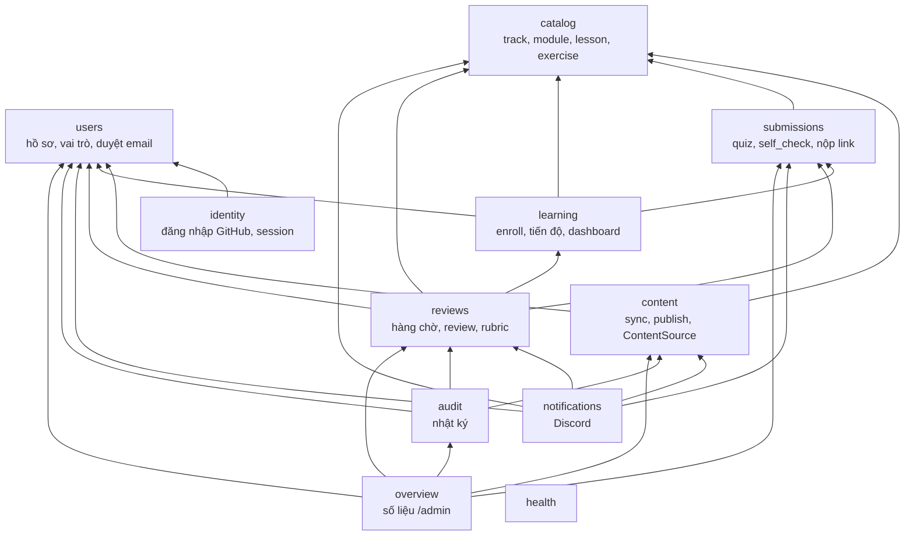

Phản ứng phụ (ghi nhật ký, gửi thông báo, cập nhật tiến độ) chạy qua domain event trong cùng tiến trình (`@nestjs/event-emitter`):

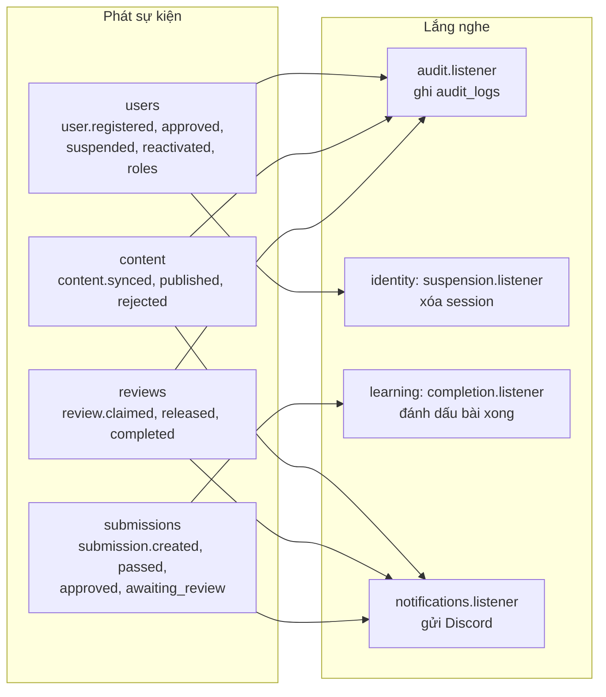

Quy tắc ranh giới, có kiểm tra trong CI (`scripts/check-boundaries.mjs`, job `build-test`):
- Code trong `modules/*` không import từ `integrations/*`. Code nghiệp vụ chỉ dùng **port** (interface) khai báo trong module, ví dụ `ContentSource`, `IdentityProvider`, `NotificationChannel`.
- Chỉ file `*.module.ts` được nối adapter vào port.

| Port | Module sở hữu | Adapter đang dùng |
| --- | --- | --- |
| `ContentSource` | content | `RegistryContentSource` (production, `CONTENT_SOURCE=registry`), `GithubContentSource`, `LocalDirContentSource` (dev) |
| `IdentityProvider` | identity | `GithubIdentityProvider` |
| `NotificationChannel` | notifications | `DiscordWebhookChannel` |

## 4. Đăng nhập và duyệt thành viên

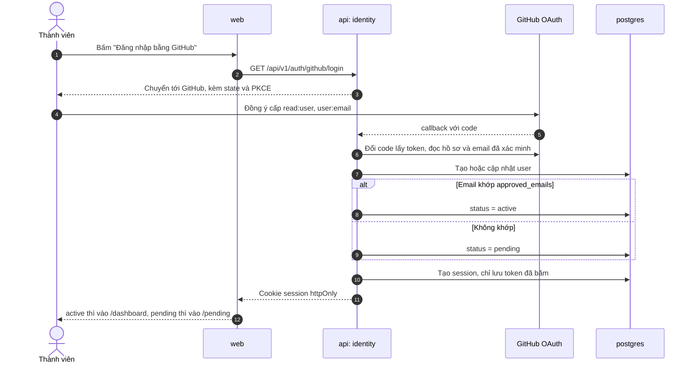

- Admin thêm email vào danh sách duyệt ở `/admin/members`. User `pending` sẽ thành `active` ở lần đăng nhập sau.
- Khóa tài khoản phát `user.suspended`; listener của identity xóa mọi session của user đó ngay.

## 5. Publish nội dung qua registry

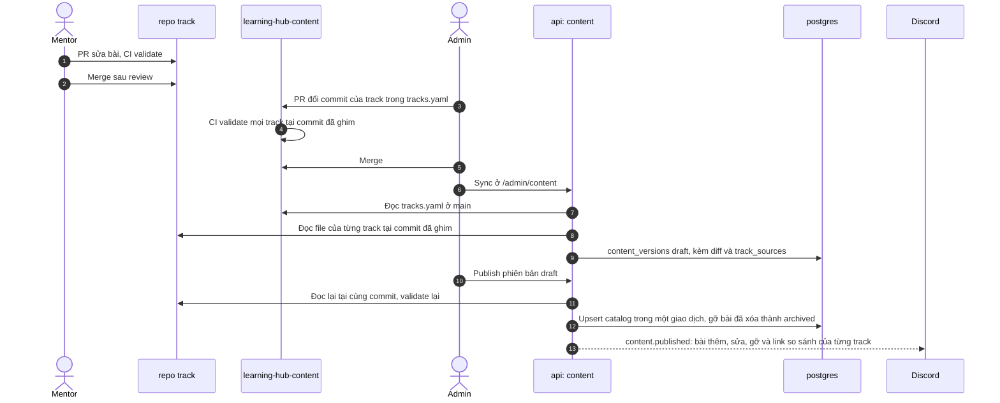

- Sync cùng một commit hai lần không tạo phiên bản mới. Mỗi lần chỉ có đúng một phiên bản ở trạng thái `published`.
- Không có bài học hay bài tập nào thay đổi thì không gửi Discord (learning-hub#26).
- Link "Sửa trên GitHub" trên trang bài học trỏ tới repo và commit của phiên bản đang publish (`sourceFor`, learning-hub#21).
- Thay vì bấm trên UI, có thể chạy lệnh: `pnpm --filter @hub/api content:sync [--sha <sha>] [--publish]`.

## 6. Nộp bài và review

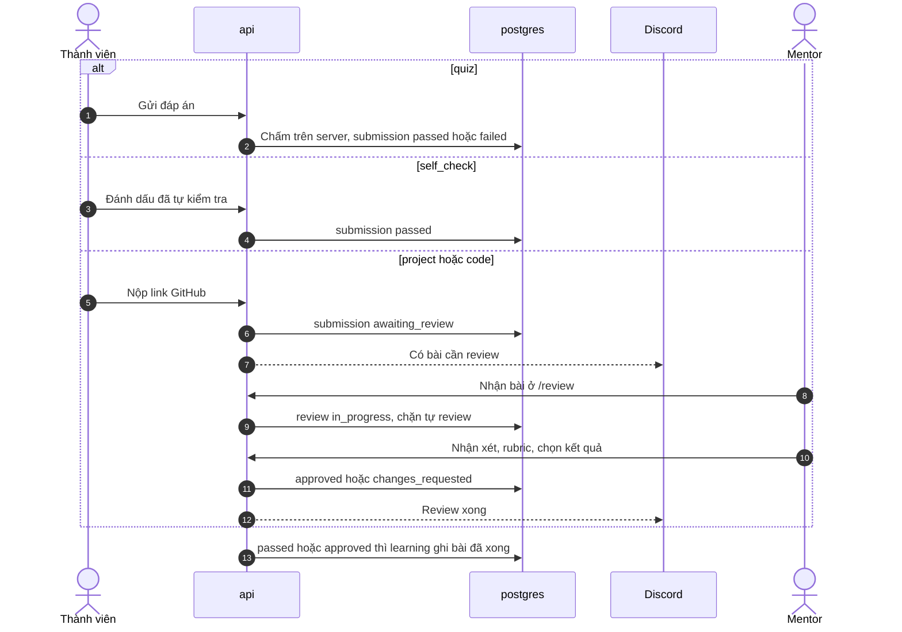

- Mỗi bài nộp chỉ có tối đa một review đang mở. Mentor có thể trả bài lại hàng chờ (`review.released`).
- Hàng chờ có bộ lọc theo track và số liệu cho mentor (learning-hub#30). Bộ lọc theo mentee chỉ hiện khi đã có ghép cặp (E8).
- Chấm tự động cho bài `code` (E6, [#4](https://github.com/hcmute-dsc/learning-hub/issues/4)) và cho SQL (E13, [#3](https://github.com/hcmute-dsc/learning-hub/issues/3)) chưa làm. Thiết kế ở ARCHITECTURE §7.

## 7. Từ PR tới production

```mermaid
flowchart LR
  Issue["Issue trên Project #1"] --> Branch["Nhánh feat/N-..."]
  Branch --> PR["Pull request"]

  subgraph Checks["Check bắt buộc trên main"]
    BT["build-test<br/>format, typecheck, test,<br/>boundaries, migrate, build, sync"]
    SE["secrets<br/>gitleaks"]
    TI["check<br/>tên PR"]
  end

  PR --> Checks
  Checks --> Review["Tự review, đăng lên PR<br/>maintainer xác nhận"]
  Review -->|squash merge| Main["main"]
  Main --> CI2["CI trên main"]
  CI2 --> Images["Deploy: build image<br/>api, web → GHCR, tag = commit"]
  Images --> SSH["SSH vào VPS<br/>chép compose và script"]
  SSH --> Up["compose pull, migrate, up -d"]
  Up --> Probe["Kiểm tra site trả lời<br/>lỗi thì job Deploy đỏ"]
  Uptime["Uptime: mỗi 15 phút"] -->|lỗi| Alert["Discord kênh vận hành"]
```

- `main` được bảo vệ từ 18/11/2026 ([WORKFLOW §7.5](WORKFLOW.md)):
  - bắt buộc PR, chỉ squash merge;
  - nhánh PR phải cập nhật theo `main` trước khi merge;
  - cấm force push.
- Deploy chạy lần lượt (`concurrency: deploy-production`). Image gắn tag theo commit, nên muốn quay lại bản cũ thì đặt `IMAGE_TAG` cũ (DEPLOYMENT).
- Nội dung không đi qua đường này: merge vào repo track không làm site đổi cho tới khi admin publish (§5).

## 8. Sao lưu

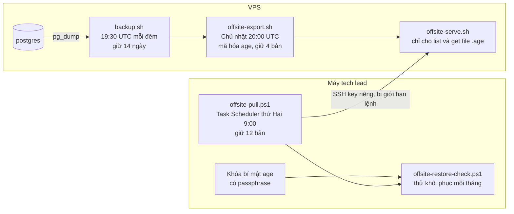

- VPS không giữ khóa giải mã. Lộ SSH key kéo bản sao thì người khác cũng chỉ lấy được file đã mã hóa.
- Cài đặt và bàn giao: `deploy/README.md` (learning-hub), DEPLOYMENT §5.

## 9. Trạng thái

Bài nộp (`submissions.status`):

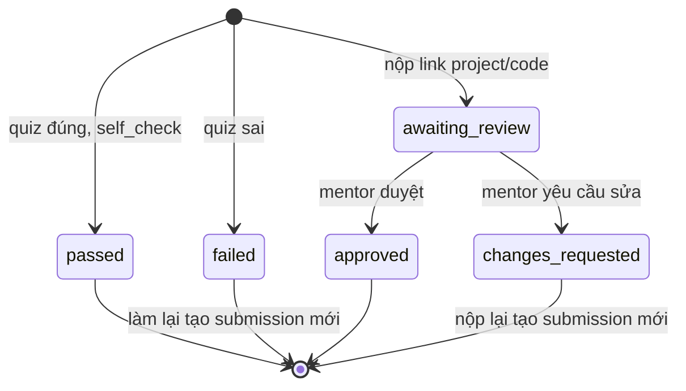

Phiên bản nội dung (`content_versions.status`):

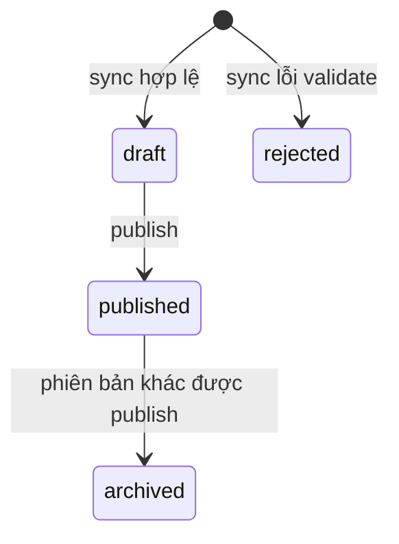

Thành viên (`users.status`): `pending` → `active` (khớp email hoặc admin duyệt), rồi `active` ⇄ `suspended` (admin khóa và mở).

Bảng và quan hệ: [DATABASE](../product/DATABASE.md).

## 10. Đang làm dở, nhớ cập nhật sơ đồ

| Việc | Sơ đồ bị ảnh hưởng |
| --- | --- |
| Hint và lời giải [#46](https://github.com/hcmute-dsc/learning-hub/issues/46) | §6, §9 |
| Chứng nhận hoàn thành track [#47](https://github.com/hcmute-dsc/learning-hub/issues/47) | §3 (module mới), §9 |
| Huy hiệu và streak [#48](https://github.com/hcmute-dsc/learning-hub/issues/48) | §3 (listener mới) |
| Thông báo trong app và email [#49](https://github.com/hcmute-dsc/learning-hub/issues/49) | §1 (SMTP), §3, §6 (gửi qua `outbox_events` thay vì gửi nền trực tiếp) |
| Chấm SQL [#3](https://github.com/hcmute-dsc/learning-hub/issues/3), chấm qua checker [#4](https://github.com/hcmute-dsc/learning-hub/issues/4) | §2 (container mới), §6 |
| Ghép mentor [#7](https://github.com/hcmute-dsc/learning-hub/issues/7) | §3, §6 |

Hiện Discord được gửi nền ngay trong tiến trình API. Lỗi chỉ ghi log `Notification not sent` và không thử lại. Bảng `outbox_events` đã có nhưng chưa dùng. API cũng chưa có cron job nào; việc định kỳ chạy bằng cron trên VPS (§8) và GitHub Actions (§7).
