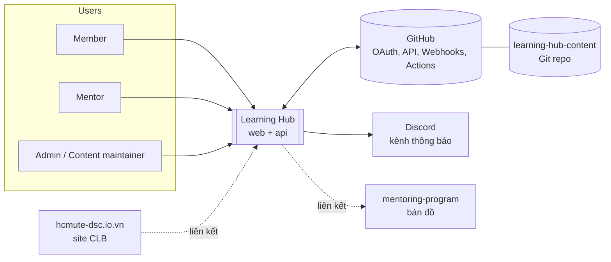
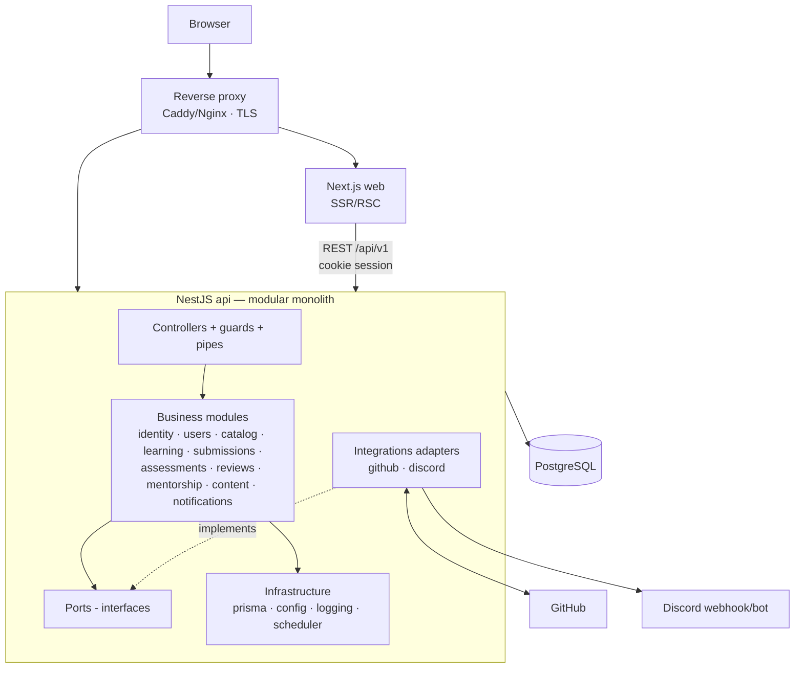
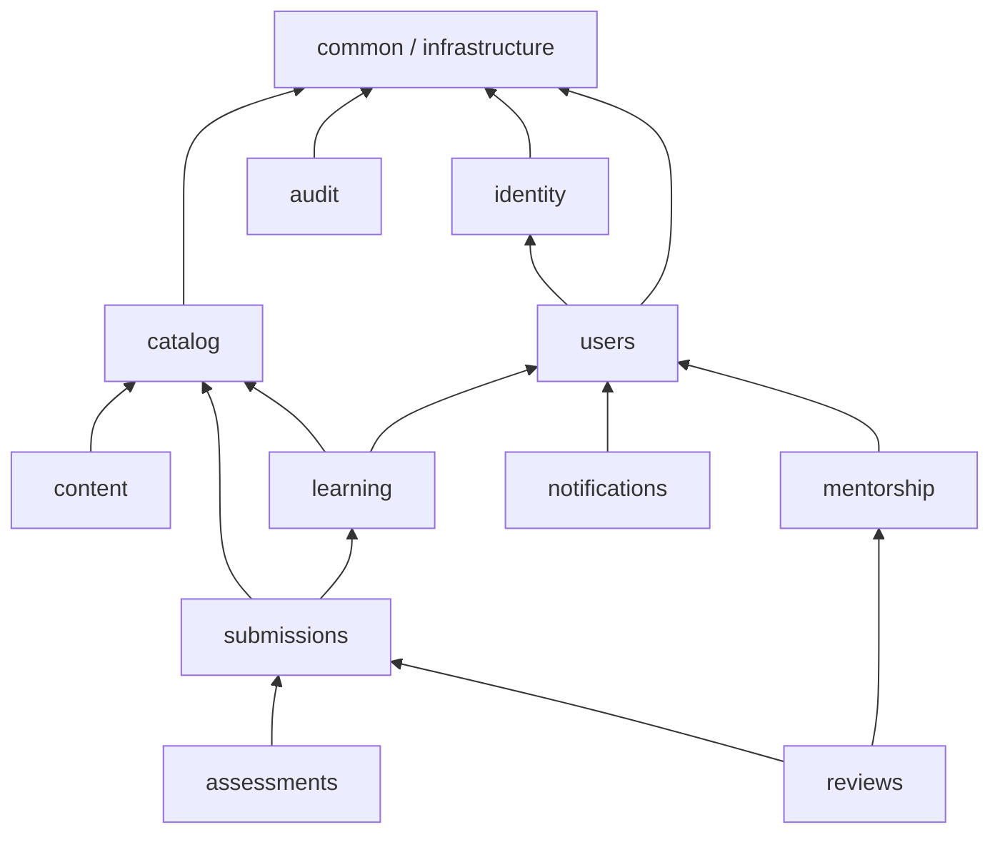
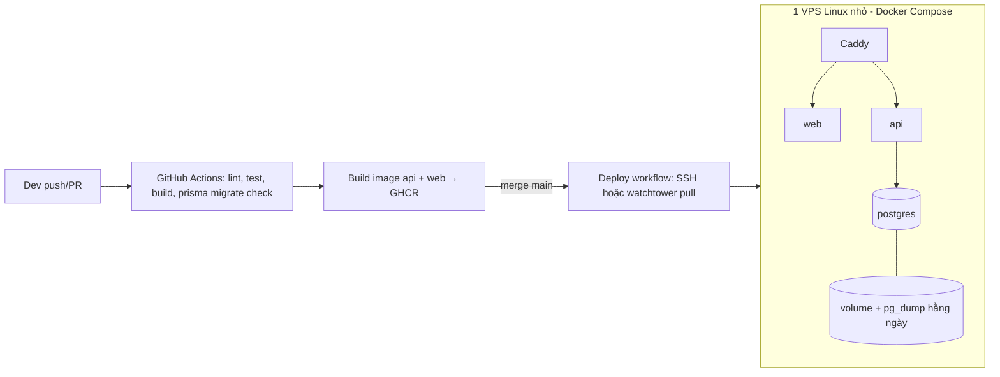

# ARCHITECTURE — Kiến trúc hệ thống

> Nguyên tắc: **đơn giản đủ để sinh viên bảo trì**. Modular monolith, 1 database, 3 tiến trình ở MVP (`web`, `api`, `postgres`). Redis/BullMQ/MinIO **không** có ở MVP (điều kiện thêm ở §8, §9).

## 1. Bối cảnh hệ thống

## 2. Kiến trúc mức cao

## 3. Ranh giới module backend

Chi tiết từng module: BACKEND-DESIGN.md. Quy tắc chung:

1. **Business module không import từ `integrations/*`.** Chúng phụ thuộc **port** (interface) khai báo ở module sở hữu, ví dụ `ContentSource`, `RepoReader`, `NotificationChannel`. Adapter ở `integrations/` cung cấp bản cài đặt, nối ở `AppModule` bằng DI token.
2. **Phụ thuộc một chiều** (không vòng):

   Chiều mũi tên = "phụ thuộc vào". `notifications` và `audit` được các module khác **kích hoạt bằng domain event**, không bị import ngược.
3. **Giao tiếp giữa module:** (a) gọi service công khai của module bên dưới (qua `exports`), hoặc (b) **domain event** in-process (`@nestjs/event-emitter`) cho phản ứng phụ (gửi thông báo, ghi audit, cập nhật tiến độ). Không truy cập bảng của module khác bằng Prisma trực tiếp.
4. Kiểm tra bằng `eslint-plugin-boundaries` (hoặc `dependency-cruiser`) trong CI — vi phạm làm CI đỏ.

## 4. Kiến trúc frontend

Next.js (App Router) + TypeScript, server components cho trang đọc (catalog, lesson), client components cho tương tác (nộp bài, review). Chỉ giao tiếp với backend qua REST/OpenAPI client sinh tự động. Chi tiết: FRONTEND-DESIGN.md.

## 5. Kiến trúc cơ sở dữ liệu

- 1 PostgreSQL, 1 schema `public`, Prisma ORM. Mọi truy cập qua repository của từng module.
- Giao dịch ở tầng application service (`prisma.$transaction`); sự kiện domain phát **sau commit**.
- Chi tiết bảng, ràng buộc, migration: DATABASE.md.
- Kích thước dự kiến: < 1 GB năm đầu; một instance nhỏ đủ.

## 6. Xác thực & phân quyền

| Điểm | Thiết kế |
| --- | --- |
| Đăng nhập | GitHub OAuth (authorization code + PKCE + `state`). Scope tối thiểu `read:user` + `user:email` (đọc mọi email đã xác minh để khớp danh sách `approved_emails`); `read:org` chỉ khi bật kiểm tra org tùy chọn. |
| Session | Cookie `__Host-` httpOnly, Secure, SameSite=Lax; session lưu trong DB (bảng `sessions`, token chỉ lưu dạng băm). **Đề xuất:** session ID ngẫu nhiên, thu hồi được; không dùng JWT cho web. |
| Phân quyền | RBAC 4 vai trò + kiểm tra **quyền sở hữu/quan hệ** (mentor chỉ thấy mentee được giao) trong policy (`can(user, action, resource)`). |
| Webhook | Không dùng session; xác thực HMAC SHA-256 (`X-Hub-Signature-256`). |

## 7. Tích hợp GitHub

Cô lập trong `integrations/github`, chỉ lộ ra các port:

| Port (do business module sở hữu) | Chức năng | Adapter GitHub |
| --- | --- | --- |
| `ContentSource` (content) | liệt kê file, đọc file tại commit SHA, lấy commit hiện tại của branch | `GithubContentSource`: GitHub REST `commits/{branch}`, `git/trees/{sha}?recursive=1`, `contents/{path}?ref={sha}` (tarball tại SHA: tối ưu sau). Dev/test: `LocalDirContentSource` (không phải adapter GitHub) |
| `RepoReader` (submissions) | kiểm tra PR/commit tồn tại, thuộc user, lấy head_sha, danh sách file đổi | Octokit pulls API |
| `CiResultReceiver` (assessments) | nhận kết quả CI | Webhook `workflow_run`, `check_run`, `pull_request` |
| `IdentityProvider` (identity) | đổi code lấy token, lấy hồ sơ, kiểm tra org | OAuth + `GET /user`, `GET /orgs/{org}/members/{user}` |

- Chọn nguồn nội dung bằng env: `CONTENT_SOURCE=local|github`; `local` đọc `CONTENT_LOCAL_DIR` (SHA giả = sha1 trên đường dẫn đã sắp xếp + nội dung, publish báo lỗi nếu thư mục đổi sau sync); `github` đọc `CONTENT_REPO` nhánh `CONTENT_BRANCH`, không cần token với repo công khai, `CONTENT_GITHUB_TOKEN` tuỳ chọn để nâng rate limit (CONTENT-SPECIFICATION §8).
- **GitHub App** (đề xuất, đích dài hạn cả cho đọc content) thay vì PAT: quyền tối thiểu `Contents: read`, `Pull requests: read`, `Checks: read`, `Actions: read`, `Metadata: read`; cài trên content repo (và repo exercise nếu private). Token cài đặt ngắn hạn, sinh từ private key.
- Webhook endpoint `/api/v1/integrations/github/webhook`: kiểm tra chữ ký, ghi `delivery_id` để chống xử lý trùng, trả 2xx nhanh, xử lý ngắn (ghi test_run); nặng hơn thì đẩy vào job nội bộ.
- Rate limit: cache ETag, ưu tiên webhook thay vì polling; đối soát định kỳ thưa (§8).
- Cách chấm bài `code` (**repo chấm do CLB sở hữu**, không tin workflow trong repo thành viên):
  1. Exercise khai báo trong `spec`: `starterTemplate` (repo template để thành viên bắt đầu), `checker` (tên workflow + thư mục test ẩn trong `learning-hub-checker`).
  2. Thành viên làm bài trong repo **công khai** của mình, rồi nộp URL PR/commit.
  3. API xác minh nguồn (repo thuộc đúng tài khoản GitHub của người nộp) → GitHub App gửi `workflow_dispatch` tới `learning-hub-checker` với input `{repo, sha, exerciseSlug, submissionId}`.
  4. Workflow của CLB checkout `repo@sha` vào thư mục riêng, chạy test ẩn (không secret, `permissions: contents: read`, timeout), ghi tóm tắt vào **check run/job summary**.
  5. Webhook `workflow_run.completed` **chỉ từ `learning-hub-checker`** (kiểm tra `repository.full_name`) → `CiResultReceiver` ghi `test_run`. Đọc `conclusion` + tóm tắt có giới hạn kích thước, không tải artifact tùy ý.

## 8. Background jobs

MVP **không dùng Redis/BullMQ**. Việc nền chạy trong tiến trình API bằng `@nestjs/schedule` (cron) và bảng `outbox`/trạng thái trong DB:

| Job | Tần suất | Mục đích |
| --- | --- | --- |
| `reconcile-test-runs` | 5 phút | Tìm submission `testing` quá 5 phút, hỏi GitHub API lấy kết quả; quá 15 phút → `errored`. |
| `content-sync-poll` (tuỳ chọn) | 15 phút | Nếu webhook push bị lỡ. |
| `discord-outbox-flush` | 1 phút | Gửi lại thông báo Discord thất bại (bảng `outbox_events`). |

**Điều kiện thêm Redis + BullMQ (Phase 2):** (a) cần chạy nhiều instance API (job trùng), (b) job > vài giây (import hàng loạt, email digest), (c) cần retry/backoff/giám sát hàng đợi. Khi đó: Redis một node, BullMQ queue `notifications`, `content-sync`, `reconcile`.

## 9. Lưu trữ file

MVP: không cho upload file (bài nộp là liên kết GitHub, nội dung nằm ở Git). Ảnh minh họa lesson nằm trong content repo và được phục vụ qua CDN/GitHub raw đã proxy cache (hoặc build copy vào `web/public/content`). **Phase 2:** nếu cần avatar tùy chỉnh/đính kèm → MinIO (S3-compatible) + signed URL, giới hạn loại/kích thước, quét tên file (SECURITY §6).

## 10. Tích hợp Discord

- Một chiều (MVP): **Incoming Webhook** gửi embed vào kênh: `#review-queue` (bài cần review), `#hub-announcements` (publish track mới). Mentee nhận thông báo cá nhân bằng DM chỉ khi đã liên kết Discord (P2).
- P2: bot `discord.js` đọc lệnh `/progress`, `/mydaily`; liên kết tài khoản bằng mã một lần. Discord **không** là nguồn sự thật: mọi trạng thái nằm ở DB.
- Adapter implement port `NotificationChannel` trong `integrations/discord`; lỗi Discord không làm hỏng giao dịch chính (ghi lỗi + retry).

## 11. Logging & giám sát

- **Pino** (nestjs-pino): JSON, `reqId` (từ header `x-request-id` hoặc sinh mới), `userId`, redaction cho `authorization`, `cookie`, token, `set-cookie`.
- Health: `/health/live`, `/health/ready` (kiểm tra DB).
- Metrics tối thiểu: số request/giây, lỗi 5xx, độ trễ p95, hàng đợi review, số test_run lỗi (endpoint `/metrics` Prometheus tuỳ chọn P2).
- Cảnh báo: lỗi 5xx và job thất bại → Discord kênh `#hub-alerts`. Không dùng dịch vụ trả phí ở MVP; Sentry free tier là tuỳ chọn.

## 12. Xử lý lỗi

- Mọi lỗi nghiệp vụ là `DomainError` (code ổn định, vd `EXERCISE_LOCKED`), map sang HTTP bởi một exception filter toàn cục → định dạng lỗi thống nhất (BACKEND-DESIGN §3.6).
- Lỗi không lường: 500 + `errorId`, log đầy đủ chuỗi gọi, không lộ chi tiết nội bộ.
- Lỗi từ GitHub/Discord: bọc thành `UpstreamError`, retry có giới hạn với backoff, không retry với 4xx.
- Frontend: error boundary theo route + toast cho thao tác (FRONTEND-DESIGN §7).

## 13. Bảo mật (tóm tắt)

Chi tiết trong SECURITY.md. Điểm kiến trúc: không chạy code thành viên trong API; secrets qua biến môi trường/secret manager; HMAC cho webhook; quyền tối thiểu cho GitHub App; CSP, CSRF, rate limit ở reverse proxy + Nest throttler.

## 14. Triển khai

| Môi trường | Mô tả |
| --- | --- |
| Local | `docker compose up` (postgres + mailhog tuỳ chọn); `pnpm dev` chạy api/web; seed roles/admin; nội dung demo bằng `content:sync --publish` từ `content-example`; GitHub OAuth app "dev". |
| Staging (tuỳ chọn) | Một compose nhỏ, content repo nhánh `staging`. |
| Production | 1 VPS được tài trợ (2 vCPU/4 GB đủ), Caddy (TLS tự động), Compose; backup `pg_dump` sang storage rẻ; image gắn tag theo commit SHA. |

**Đã chốt (16/11/2026):** production chạy trên **1 VPS** do Chủ nhiệm CLB đương nhiệm (GitHub `TienNHM`) tài trợ; người này cũng giữ GitHub App/OAuth app, domain và secret. Docker Compose như sơ đồ trên. Để giảm bus factor, runbook bàn giao (MVP-BACKLOG E11) liệt kê mọi tài khoản/secret theo chức danh (không chứa giá trị) để chuyển quyền sở hữu cho Chủ nhiệm kế tiếp. Kiến trúc vẫn không phụ thuộc nhà cung cấp.

## 15. Đánh đổi & phương án thay thế

| Quyết định | Vì sao | Khi nào xem lại |
| --- | --- | --- |
| Modular monolith | 1 repo, 1 deploy, dễ debug | Khi có đội > 15 dev hoặc runner cần tách (đã tách sẵn là service riêng) |
| Không Redis ở MVP | Ít thành phần phải vận hành | Điều kiện §8 |
| REST + OpenAPI thay vì GraphQL | Đơn giản, công cụ sinh client, dễ dạy | Nếu UI cần query phức tạp |
| Session trong DB | Thu hồi được, không phụ thuộc JWT | Nếu scale ngang lớn |
| Sync content vào DB | Truy vấn nhanh, FK | Nếu nội dung quá lớn |
