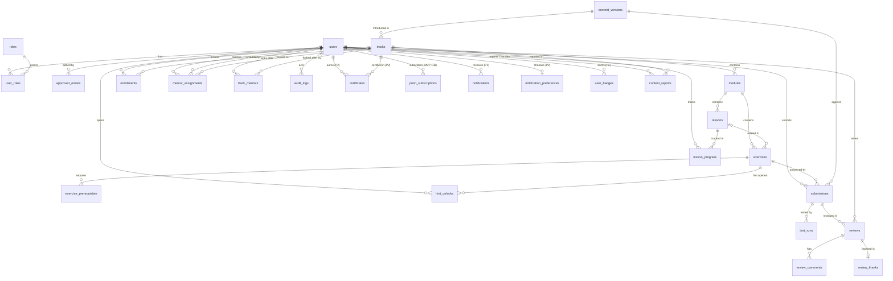

# DATABASE — Thiết kế PostgreSQL

> PostgreSQL 16 + Prisma. Quy ước: bảng `snake_case` số nhiều, cột `snake_case` (Prisma map bằng `@map`). Khóa chính `uuid` (v7 sinh ở ứng dụng, để sắp xếp theo thời gian). Thời gian `timestamptz` (UTC). Nhãn: **[MVP]**, **[MVP-Full]** (thuộc MVP, làm sau MVP-Lite) hoặc **[P2]**.
> Nguyên tắc: **schema MVP gọn** — 18 bảng domain (kể cả bảng nối và `approved_emails`) + 3 bảng hạ tầng nhỏ (`sessions`, `webhook_deliveries`, `outbox_events`). MVP-Full thêm bảng `push_subscriptions` và cột `users.leaderboard_opt_in` (quyết định 16/11/2026, DECISIONS ADR-08); bảng xếp hạng tính bằng một truy vấn lúc đọc, không lưu điểm; learning-hub#76 thêm `users.discord_user_id`, `users.discord_username` và `outbox_events.idempotency_key`. Các bảng P2 chỉ mô tả ngắn, chưa tạo migration, trừ `user_badges` (§3.16d), `certificates` (§3.16e) và `notifications`, `notification_preferences` (§3.16f), đã làm.

## 1. Phân loại dữ liệu

| Loại | Bảng | Nguồn sự thật |
| --- | --- | --- |
| Nội dung (đọc là chính) | `tracks`, `modules`, `lessons`, `exercises`, `exercise_prerequisites`, `content_versions` | **Git** (DB là bản sao có chỉ mục; catalog chỉ được ghi khi **publish** một content version, sync chỉ ghi `content_versions`) |
| Người dùng & quyền | `users`, `roles`, `user_roles`, `approved_emails` | DB |
| Học tập | `enrollments`, `lesson_progress`, `submissions`, `test_runs` | DB |
| Mentoring | `mentor_assignments`, `track_mentors`, `reviews`, `review_comments`, `review_thanks`, `content_reports` | DB |
| Vận hành | `audit_logs` | DB |
| Thông báo (MVP-Full) | `push_subscriptions` | DB |
| Thông báo trong app (P2, F13) | `notifications`, `notification_preferences` | DB |
| Phase 2 | `certificates`, `achievements`, `user_achievements` | DB |

## 2. ERD

Ghi chú: `exercise_prerequisites` là quan hệ tự tham chiếu `exercises`↔`exercises`. Mentor/mentee đều là `users` (hai FK trong `mentor_assignments`).

## 3. Chi tiết bảng

Ký hiệu: PK, FK, UQ (unique), IX (index). Mọi bảng có `created_at timestamptz not null default now()`; bảng có `updated_at` ghi rõ.

### 3.1 `users` [MVP]
**Mục đích:** tài khoản thành viên, định danh qua GitHub.

| Cột | Kiểu | Ghi chú |
| --- | --- | --- |
| id | uuid | PK |
| github_id | bigint | not null, UQ — định danh ổn định (login có thể đổi) |
| github_login | text | not null, IX |
| display_name | text | not null |
| email | citext | null, UQ (partial: `where email is not null`) |
| avatar_url | text | null |
| status | text | `pending` (chờ duyệt) \| `active` \| `suspended`; default `pending`, tự thành `active` nếu có email đã xác minh trên GitHub khớp `approved_emails` (hoặc là admin bootstrap) |
| last_login_at | timestamptz | null |
| leaderboard_opt_in | boolean | not null default false — [MVP-Full] chỉ người tự bật mới xuất hiện trên bảng xếp hạng (ADR-08); đã làm ([learning-hub#5](https://github.com/hcmute-dsc/learning-hub/issues/5)) |
| discord_user_id | text | null, UQ, CHECK chỉ chữ số (snowflake) — [MVP-Full] tài khoản Discord thành viên tự kết nối trong `/settings` (OAuth2 scope `identify`), chỉ để tag trong bài đăng bảng xếp hạng tuần; **không** phải đồng ý lên bảng ([learning-hub#76](https://github.com/hcmute-dsc/learning-hub/issues/76)) |
| discord_username | text | null — tên Discord lúc kết nối, hiện trong `/settings` |
| show_achievements | boolean | not null default true — [P2] `false` ẩn huy hiệu và streak trên dashboard và hồ sơ (PRD §6.1, F12) |
| updated_at, deleted_at | timestamptz | `deleted_at` = xóa mềm |

Quan hệ: 1–N `user_roles`, `enrollments`, `submissions`, …

### 3.1b `approved_emails` [MVP]
**Mục đích:** danh sách email thành viên do CLB duy trì để tự duyệt tài khoản (quyết định 16/11/2026). Khi đăng nhập, mọi email **đã xác minh** trên GitHub của người dùng được so với bảng này; khớp → `users.status = 'active'`.

| Cột | Kiểu | Ghi chú |
| --- | --- | --- |
| email | citext | PK — lưu đã `trim` + chữ thường |
| note | text | null — vd "Gen 7", "form 2026-11" |
| added_by | uuid | FK → users, null (import bởi hệ thống/seed) |
| created_at | timestamptz | |

Không có FK tới `users` theo email (chỉ dùng lúc khớp). Admin nhập thêm hoặc **thay toàn bộ** danh sách trong một giao dịch. Dữ liệu cá nhân: chỉ admin đọc/ghi; mọi thay đổi ghi `audit_logs` (`approved_emails.import`/`approved_emails.replace`, metadata chỉ số lượng thêm/bớt); không xuất cho member/mentor.

### 3.2 `roles` [MVP]
Danh mục vai trò (seed cố định): `member`, `mentor`, `content_maintainer`, `admin`.

| Cột | Kiểu | Ghi chú |
| --- | --- | --- |
| id | smallint | PK |
| code | text | not null, UQ |
| description | text | |

*Permission:* MVP **không** có bảng `permissions` riêng; ma trận quyền nằm trong code (`policies`) và tài liệu SECURITY. Lý do: 4 vai trò cố định, bảng permission tăng độ phức tạp mà chưa có lợi. Thêm khi có yêu cầu quyền động (P2).

### 3.3 `user_roles` [MVP]
| Cột | Kiểu | Ghi chú |
| --- | --- | --- |
| user_id | uuid | FK → users, on delete cascade |
| role_id | smallint | FK → roles |
| granted_by | uuid | FK → users, null (system) |
| PK | (user_id, role_id) | |

### 3.4 `content_versions` [MVP]
**Mục đích:** mỗi lần sync nội dung từ Git tạo một version, truy vết tới commit; publish version đó mới ghi catalog.

| Cột | Kiểu | Ghi chú |
| --- | --- | --- |
| id | uuid | PK |
| source_repo | text | not null, vd `hcmute-dsc/learning-hub-content` (với registry: repo registry, commit là commit của registry) |
| commit_sha | char(40) | not null, check `~ '^[0-9a-f]{40}$'` |
| status | text | `draft` (sync hợp lệ, chưa publish) \| `published` \| `superseded` (bị version publish sau thay) \| `rejected` (sync không qua validate) |
| summary | jsonb | `draft`: diff theo loại (track/module/lesson/exercise: added/changed/removed/unchanged); `rejected`: danh sách lỗi `{path, message}` |
| summary.solutionsFrom | (trong `summary`) | `{repo, commitSha}` của repo checker riêng tư mà lời giải tham khảo được đọc lúc sync/publish, `null` khi tắt (`SOLUTIONS_SOURCE=none`) — learning-hub#46 |
| track_sources | jsonb | null; chỉ khi đọc qua registry (ADR-10): `{"<slug track>": {"repo": "owner/learning-hub-track-<slug>", "commitSha": "…"}}`, để footer, ảnh và link sửa bài trỏ tới repo của track (migration `20261118000100_track_sources`) |
| synced_by, published_by | uuid | FK → users, null |
| published_at | timestamptz | null |
| UQ | (source_repo, commit_sha) | một commit = một version |
| partial UQ | `status = 'published'` | **chỉ 1 version published tại một thời điểm** (`create unique index … on content_versions ((true)) where status='published'`) |

Sync idempotent nhờ UQ `(source_repo, commit_sha)`. Publish (1 giao dịch): version published trước → `superseded`; upsert item mới/đổi (theo `id = uid`, so `content_hash`) với `content_version_id` = version này; item biến mất → `status = archived`; thay `exercise_prerequisites`; version → `published`.

### 3.5 `tracks` [MVP]
| Cột | Kiểu | Ghi chú |
| --- | --- | --- |
| id | uuid | PK = `uid` trong track.yaml (UUID, khuyến nghị v7), ổn định giữa các lần sync — xem CONTENT-SPECIFICATION §2. Module/lesson/exercise cũng vậy |
| slug | text | not null, UQ |
| title | text | not null |
| summary | text | |
| level | text | `beginner` \| `intermediate` \| `advanced` |
| language | text | default `vi` |
| est_hours | smallint | |
| position | int | thứ tự hiển thị |
| tags | text[] | GIN index |
| starter_repo | text | null — `owner/repo` của repo mẫu của track (một repo cho cả track, mỗi bài `code` một thư mục) |
| setup_md | text | null — `docs/setup.md` của track, trang "Cài đặt" (CONTENT-SPECIFICATION §3.1b). Migration `20261119190000_track_docs` |
| resources_md | text | null — `docs/resources.md` của track, trang "Tài liệu thêm" (§3.1b) |
| glossary | jsonb | null — `glossary.yaml` của track, trang "Từ vựng" (CONTENT-SPECIFICATION §3.1c): mảng `{term, anchor, expansion, literal, meaning, example, see}` theo thứ tự trong file; null khi track không có. Migration `20261123120000_track_glossary` |
| status | text | `active` \| `archived` (bị gỡ khỏi Git khi publish, hoặc `status: archived` trong track.yaml) |
| content_version_id | uuid | FK → content_versions (version **published** gần nhất thêm/sửa bản ghi; sync không đổi cột này) |
| source_path | text | đường dẫn trong repo |
| content_hash | text | sha256 nội dung đã chuẩn hóa, để diff khi sync và để publish bỏ qua thứ không đổi |
| updated_at | timestamptz | |

IX: `(status, position)`, GIN `(tags)`.

### 3.6 `modules` [MVP]
| Cột | Kiểu | Ghi chú |
| --- | --- | --- |
| id | uuid | PK |
| track_id | uuid | FK → tracks, on delete restrict |
| slug | text | UQ `(track_id, slug)` |
| title, summary | text | |
| position | int | UQ `(track_id, position)` deferrable |
| status, content_version_id, source_path, content_hash, updated_at | | như `tracks` |

### 3.7 `lessons` [MVP]
| Cột | Kiểu | Ghi chú |
| --- | --- | --- |
| id | uuid | PK |
| module_id | uuid | FK → modules |
| slug | text | UQ `(module_id, slug)` |
| title | text | |
| body_md | text | Markdown đã đọc từ Git (nội dung lớn, nhưng < ~200 KB) |
| est_minutes | smallint | |
| terms | text[] | default `{}` — `terms:` trong front matter: từ bài này giới thiệu, viết như trong file (§3.1c). Migration `20261123120000_track_glossary` |
| position | int | UQ `(module_id, position)` deferrable |
| status, content_version_id, source_path, content_hash, updated_at | | |

### 3.8 `exercises` [MVP]
| Cột | Kiểu | Ghi chú |
| --- | --- | --- |
| id | uuid | PK |
| module_id | uuid | FK → modules |
| lesson_id | uuid | FK → lessons, null (bài gắn với lesson nào) |
| slug | text | UQ `(module_id, slug)` |
| title | text | |
| type | text | `code` (CI chấm) \| `quiz` (chấm trong app) \| `project` (mentor review) \| `self_check` (tự đối chiếu, không chấm) |
| difficulty | text | `easy` \| `medium` \| `hard` |
| statement_md | text | đề bài |
| spec | jsonb | cấu hình theo type: quiz (câu hỏi/đáp án), code (`starterPath` trong repo mẫu của track, workflow, ngôn ngữ) |
| hints | jsonb | [P2] not null default `'[]'`; `[{position, cost, bodyMd}]` từ `hints/NN.md` (CONTENT-SPECIFICATION §3.7). API chỉ trả `bodyMd` của hint member đã mở (SECURITY §2) |
| solution_md | text | [P2] null; lời giải tham khảo đọc từ repo checker **riêng tư** lúc publish (§3.8). API chỉ trả khi member đã hoàn thành bài (SECURITY §2) |
| mentor_notes_md | text | null; từ `mentor-notes.md` của bài (CONTENT-SPECIFICATION §3.10, learning-hub#43). Chỉ trang review của mentor/admin trả về; nội dung vẫn công khai trong repo track (migration `20261119140000_exercise_mentor_notes`) |
| requires_review | boolean | not null default false (project mặc định true) |
| position | int | |
| status, content_version_id, source_path, content_hash, updated_at | | |

Check: `type in (...)`; `spec` được validate bằng Zod (`@hub/content`) khi sync và publish. `hints` và `solution_md` không bao giờ được trả nguyên cho member: `exercise-view.ts` chỉ chọn phần member được xem (migration `20261119000100_exercise_hints`).

### 3.9 `exercise_prerequisites` [MVP]
| Cột | Kiểu | Ghi chú |
| --- | --- | --- |
| exercise_id | uuid | FK → exercises, cascade |
| required_exercise_id | uuid | FK → exercises |
| PK | (exercise_id, required_exercise_id) | |
| check | `exercise_id <> required_exercise_id` | |

Chống vòng: kiểm tra DAG trong bước validate content (không dùng trigger).

### 3.9b `hint_unlocks` [P2]
**Mục đích:** ghi ai mở hint nào của bài nào (PRD F11), để tính số liệu. Mở hint **không** trừ điểm.

| Cột | Kiểu | Ghi chú |
| --- | --- | --- |
| user_id | uuid | FK → users |
| exercise_id | uuid | FK → exercises (restrict) |
| position | int | thứ tự hint, như `NN` của `hints/NN.md`; check `position >= 1` |
| opened_at | timestamptz | default now() |
| PK | (user_id, exercise_id, position) | mở lại cùng hint không thêm dòng |

IX: `(exercise_id)` (thống kê theo bài). Hint mở **theo thứ tự**, và chỉ khi số lần nộp ≥ `cost` của hint (quy tắc ở `submissions/hints.ts`). Nếu nội dung đổi số hint, dòng có `position` lớn hơn số hint hiện có bị bỏ qua khi hiển thị. Migration `20261119000100_exercise_hints`.

### 3.10 `enrollments` [MVP]
| Cột | Kiểu | Ghi chú |
| --- | --- | --- |
| id | uuid | PK |
| user_id | uuid | FK → users |
| track_id | uuid | FK → tracks |
| status | text | `active` \| `completed` \| `dropped` |
| cohort | text | null — nhãn đợt học, vd `sql-2027-spring` (lọc tiến độ theo đợt; lịch/deadline đầy đủ ở P2) |
| enrolled_at, completed_at | timestamptz | |
| UQ | (user_id, track_id) | enroll idempotent |
| IX | (track_id, status) | thống kê |

### 3.11 `lesson_progress` [MVP]
| Cột | Kiểu | Ghi chú |
| --- | --- | --- |
| user_id | uuid | FK → users |
| lesson_id | uuid | FK → lessons |
| status | text | `in_progress` \| `completed` |
| completed_at | timestamptz | |
| PK | (user_id, lesson_id) | |

Tiến độ **exercise** không có bảng riêng: suy ra từ `submissions` (có submission `passed`/`approved`). Giảm trùng dữ liệu; tạo view `v_exercise_progress` (xem §6).

### 3.12 `submissions` [MVP]
| Cột | Kiểu | Ghi chú |
| --- | --- | --- |
| id | uuid | PK |
| user_id | uuid | FK → users |
| exercise_id | uuid | FK → exercises |
| content_version_id | uuid | FK → content_versions — đề tại thời điểm nộp |
| attempt | int | not null; UQ `(user_id, exercise_id, attempt)` |
| source_type | text | `github_pr` \| `github_commit` \| `quiz_answers` \| `self_check` \| `link` (bài `project` chỉ nộp URL, review thủ công) \| `sql_query` ([MVP-Full] câu truy vấn chấm bằng `sql-checker`, lưu ở `answers.sql`) |
| repo_full_name | text | vd `linh/dsc-git-ex1` |
| pr_number, head_sha | int, char(40) | null theo source_type |
| source_url | text | |
| answers | jsonb | cho quiz |
| note | text | |
| status | text | `submitted`, `testing`, `passed`, `failed`, `awaiting_review`, `approved`, `changes_requested`, `errored` |
| idempotency_key | text | UQ `(user_id, idempotency_key)` where not null |
| submitted_at, updated_at | timestamptz | |

IX: `(user_id, exercise_id, attempt desc)`, `(status, submitted_at)` (hàng đợi), `(repo_full_name, head_sha)` (map webhook).
Quy tắc: submission **bất biến** về nội dung bài nộp; chỉ `status`/`updated_at` đổi. Không xóa cứng (xem retention).

### 3.12b `test_runs` [MVP]
| Cột | Kiểu | Ghi chú |
| --- | --- | --- |
| id | uuid | PK |
| submission_id | uuid | FK → submissions, cascade |
| provider | text | `github_checker` (repo `learning-hub-checker`) \| `internal_quiz` \| `sql_checker` ([MVP-Full], ADR-07) (tương lai: `runner`) |
| external_run_id | bigint | null; UQ `(provider, external_run_id)` — chống webhook trùng |
| status | text | `queued`, `running`, `passed`, `failed`, `errored` |
| summary | jsonb | số test pass/fail, thời lượng, thông báo ngắn (≤ 8 KB, đã lọc) |
| run_url | text | link log trên GitHub |
| started_at, finished_at | timestamptz | |

IX: `(submission_id, created_at desc)`.

### 3.13 `reviews` [MVP]
| Cột | Kiểu | Ghi chú |
| --- | --- | --- |
| id | uuid | PK |
| submission_id | uuid | FK → submissions |
| reviewer_id | uuid | FK → users (mentor) |
| status | text | `in_progress` \| `approved` \| `changes_requested` |
| summary_md | text | |
| submitted_at | timestamptz | khi kết luận |
| partial UQ | `(submission_id) where status='in_progress'` | tối đa 1 review đang mở |

### 3.14 `review_comments` [MVP]
| Cột | Kiểu | Ghi chú |
| --- | --- | --- |
| id | uuid | PK |
| review_id | uuid | FK → reviews, cascade |
| author_id | uuid | FK → users |
| file_path | text | null (comment chung) |
| line_start, line_end | int | null |
| body_md | text | CHECK 1–2000 ký tự (migration `20261123000000_review_thread`) |
| parent_id | uuid | FK → review_comments, null (trả lời) |
| resolved_at | timestamptz | |

**Trao đổi sau review (learning-hub#41):** sau khi mentor hoàn thành review, thành viên nộp bài, mentor đã review và admin viết tin nhắn trên review đó. Tin nhắn là dòng `review_comments` với `file_path` null; tối đa 100 tin mỗi review. Mentor khác không đọc được. Tin mới báo qua chuông cho phía còn lại, không chép nội dung tin vào thông báo.

### 3.14b `review_thanks` [MVP-Full, learning-hub#41]
Lời cảm ơn của thành viên cho mentor, một lần cho mỗi review đã xong.

| Cột | Kiểu | Ghi chú |
| --- | --- | --- |
| id | uuid | PK |
| review_id | uuid | FK → reviews, cascade; UQ (một lời cảm ơn mỗi review) |
| mentee_id | uuid | FK → users (người nộp bài) |
| mentor_id | uuid | FK → users (người review) |
| body | text | CHECK 1–280 ký tự, chữ thường (không Markdown) |
| is_public | boolean | default false. Chỉ mentor bật; bật thì hiện trên hồ sơ `/u/[login]` của mentor, kèm tên người gửi |
| created_at | timestamptz | |

IX `(mentor_id, is_public, created_at desc)`.

### 3.15 `mentor_assignments` [MVP]
| Cột | Kiểu | Ghi chú |
| --- | --- | --- |
| id | uuid | PK |
| mentee_id | uuid | FK → users |
| mentor_id | uuid | FK → users, **null khi `requested`** |
| track_id | uuid | FK → tracks, null (cả CLB) |
| status | text | `requested` \| `active` \| `declined` \| `ended` |
| request_note | text | |
| decided_by | uuid | FK → users |
| started_at, ended_at | timestamptz | |
| check | `mentor_id is null or mentor_id <> mentee_id` | |
| partial UQ | `(mentee_id, track_id) where status in ('requested','active')` | 1 yêu cầu/assignment mở mỗi track (dùng `coalesce(track_id, '0000…')` cho null) |

Admin gán ở `/admin/mentors?track=` (US-11, [learning-hub#120](https://github.com/hcmute-dsc/learning-hub/issues/120)):
- Chỉ thành viên đã ghi danh track (enrollment không `dropped`) mới được gán mentor. Mentor phải là tài khoản `active` có vai trò `mentor`.
- Gán mới tạo dòng `active` (`decided_by` = admin, `started_at`). Đổi mentor thì dòng cũ thành `ended` (ghi `ended_at`) rồi tạo dòng mới. Bỏ mentor thì dòng thành `ended`. Không xoá dòng nào.
- Thành viên đã tự xin mentor (dòng `requested`, #7): admin gán thì chính dòng đó chuyển sang `active`; admin bỏ thì thành `declined`.
- Một mentor kèm tối đa `MENTOR_MAX_MENTEES` dòng `active` trên mọi track. Số này được đếm rồi ghi dưới advisory lock theo mentor, nên hai admin không cùng lấy được chỗ cuối.
- Audit: `mentor.assign` / `mentor.unassign`, metadata gồm `menteeLogin`, `track`, `mentorLogin`, `previousMentorLogin`.
- Hàng đợi review đọc các dòng `active` để làm bộ lọc "Mentee của tôi" và đếm mentee không hoạt động.

### 3.15b `track_mentors` [MVP-Full]

Mentor phụ trách một track ([learning-hub#120](https://github.com/hcmute-dsc/learning-hub/issues/120)). Admin giao ở `/admin/mentors`; trang track hiện tên mentor phụ trách cho thành viên. Một track có nhiều mentor, một mentor phụ trách nhiều track. Không xoá dòng: bỏ giao thì ghi `ended_at`/`ended_by`, nên lịch sử ai phụ trách track nào vẫn còn. Migration `20261126000000_track_mentors`.

| Cột | Kiểu | Ghi chú |
| --- | --- | --- |
| id | uuid | PK |
| track_id | uuid | FK → tracks (restrict) |
| mentor_id | uuid | FK → users (restrict); lúc giao phải `active`, chưa xoá, có vai trò `mentor` (admin không tự đủ điều kiện) |
| assigned_by | uuid | FK → users (admin giao), set null |
| started_at | timestamptz | default now() |
| ended_at | timestamptz | null = đang phụ trách |
| ended_by | uuid | FK → users (admin bỏ giao), set null |
| check | `ended_at is null or ended_at >= started_at` | |
| partial UQ | `(track_id, mentor_id) where ended_at is null` | một dòng mở mỗi track/mentor; hai admin bấm cùng lúc → 409 |

IX `(mentor_id)`. Mentor bị thu vai trò `mentor` hoặc bị tạm khóa vẫn giữ dòng mở nhưng không hiện ở `/admin/mentors` và trang track; cấp lại vai trò thì các track hiện lại. Audit: `mentor.track_assign`, `mentor.track_end` (metadata `mentorId`, `mentorLogin`, `track`).

### 3.16 `audit_logs` [MVP]
| Cột | Kiểu | Ghi chú |
| --- | --- | --- |
| id | bigint | PK identity (ghi tuần tự) |
| actor_id | uuid | FK → users, null (system) |
| action | text | vd `content.publish`, `role.grant`, `mentor.assign` |
| entity_type, entity_id | text | |
| metadata | jsonb | không chứa token/secret |
| ip, user_agent | inet, text | tùy chọn |
| created_at | timestamptz | |

IX: `(entity_type, entity_id)`, `(actor_id, created_at desc)`. Append-only (REVOKE UPDATE/DELETE cho role ứng dụng).

### 3.16b Bảng hạ tầng [MVP]
Ba bảng kỹ thuật nhỏ, không thuộc domain học tập:

| Bảng | Cột chính | Ràng buộc / index |
| --- | --- | --- |
| `sessions` | `id` (text, token ngẫu nhiên đã băm sha256) PK, `user_id` FK→users cascade, `expires_at`, `last_seen_at`, `user_agent`, `ip` | IX `(user_id)`, IX `(expires_at)` để dọn dẹp |
| `webhook_deliveries` | `delivery_id` (text) PK — `X-GitHub-Delivery`, `event`, `received_at`, `processed_at` null | chống xử lý trùng; dọn sau 30 ngày |
| `outbox_events` | `id` bigint identity PK, `type`, `payload jsonb`, `status` (`pending`\|`sent`\|`failed`), `attempts` int, `next_attempt_at`, `last_error` | IX `(status, next_attempt_at)`; hàng đợi thông báo có retry (§3.16f). `type`: `inbox.review_completed`, `inbox.review_requested`, `inbox.track_published`, `email.digest`, `discord.leaderboard_week` (bài đăng bảng xếp hạng tuần, learning-hub#76). `idempotency_key` text null UQ: dòng thứ hai cùng key không được ghi (vd `leaderboard-week:2026-W47`). Các tin Discord khác vẫn gửi thẳng, chưa qua bảng này |
| `leaderboard_week_posts` | `week_id` text PK (CHECK `YYYY-Www`), `discord_message_id` text not null (CHECK snowflake), `posted_at`, `updated_at` | [MVP-Full] một dòng mỗi tuần đã đăng bảng xếp hạng lên Discord: giữ id tin để admin sửa bài ("Cập nhật", learning-hub#83). Tin bị xoá trên Discord thì dòng bị xoá cùng dòng outbox của tuần đó để đăng lại |

### 3.16c `push_subscriptions` [MVP-Full]
**Mục đích:** subscription Web Push của từng thiết bị/trình duyệt (DECISIONS ADR-08, ARCHITECTURE §10).

| Cột | Kiểu | Ghi chú |
| --- | --- | --- |
| id | uuid | PK |
| user_id | uuid | FK → users, on delete cascade; IX |
| endpoint | text | not null, UQ — URL push service (chỉ host trong danh sách cho phép, SECURITY §5) |
| p256dh | text | not null — khóa công khai P-256 của trình duyệt (base64url) |
| auth | text | not null — auth secret của subscription (base64url) |
| user_agent | text | null — hiển thị "thiết bị" trong cài đặt (rút gọn) |
| created_at | timestamptz | |
| last_used_at | timestamptz | null — lần gửi thành công gần nhất |

Quy tắc: đăng ký lại cùng `endpoint` → upsert; push service trả 404/410 → xóa dòng; người dùng tắt trên thiết bị → xóa dòng.

### 3.16d `user_badges` [P2]
**Mục đích:** huy hiệu thành viên đã đạt (PRD §6.1, F12; migration `20261118120000_badges`, learning-hub#48).

| Cột | Kiểu | Ghi chú |
| --- | --- | --- |
| user_id | uuid | FK → users, on delete cascade |
| badge | text | not null — mã huy hiệu như `first_lesson`; CHECK `^[a-z0-9_]{1,40}$` |
| awarded_at | timestamptz | not null default now() |

PK `(user_id, badge)` → cấp huy hiệu idempotent (`insert … on conflict do nothing`). Danh sách huy hiệu và điều kiện nằm trong code (`packages/shared` `achievements.ts`), không có bảng `achievements`: thêm huy hiệu không cần migration, CHECK chỉ kiểm định dạng mã. Mã không còn trong code thì bị bỏ qua khi đọc. Streak không lưu, tính từ `lesson_progress` và `submissions`.

### 3.16e `certificates` [P2]
**Mục đích:** chứng nhận hoàn thành track có link xác minh công khai (PRD F19, quy tắc PRD §6.2; learning-hub#47, migration `20261119000200_certificates`). Tên, track và commit được **chép vào** lúc cấp, để chứng nhận luôn nói đúng điều đã đúng vào ngày cấp.

| Cột | Kiểu | Ghi chú |
| --- | --- | --- |
| id | uuid | PK |
| code | text | not null, UQ; CHECK `^[a-z2-7]{24}$` — 120 bit ngẫu nhiên, phần không đoán được của `/certificates/:code` |
| user_id | uuid | FK → users (restrict) |
| track_id | uuid | FK → tracks (restrict) |
| recipient_name | text | not null — `users.display_name` lúc cấp |
| track_slug, track_title | text | not null — lúc cấp |
| content_repo | text | not null — repo của track (registry: repo riêng của track, ADR-10) |
| commit_sha | char(40) | not null; CHECK hex chữ thường — commit nội dung đang publish lúc cấp |
| completed_at | timestamptz | not null — `enrollments.completed_at` |
| issued_at | timestamptz | default now() |
| hidden | boolean | default false — ẩn khỏi hồ sơ; link công khai vẫn mở |
| revoked_at | timestamptz | null |
| revoked_by | uuid | null, FK → users (set null) |
| revoke_reason | text | null; ≤ 280 ký tự; CHECK `(revoked_at is null) = (revoke_reason is null)`; chỉ admin thấy |
| UQ | (user_id, track_id) | cấp một lần; race giữa hai request do khóa này quyết định |
| IX | (issued_at desc) | danh sách admin |

Ghi: chỉ `CertificatesRepository` (module `certificates`) đọc/ghi bảng này. Thu hồi dùng `update … where revoked_at is null` nên hai admin bấm cùng lúc chỉ một người thành công (người kia nhận 409).

### 3.16g `content_reports` [MVP-Full, learning-hub#121]
**Mục đích:** "Báo lỗi nội dung": thành viên báo lỗi trên trang bài học, bài tập, Cài đặt / Tài liệu thêm, Từ vựng; admin và mọi mentor xử lý ở `/admin/content-reports`. Migration `20261125120000_content_reports`.

| Cột | Kiểu | Ghi chú |
| --- | --- | --- |
| id | uuid | PK (v7) |
| reporter_id | uuid | FK → users (restrict) |
| track_id | uuid | FK → tracks (restrict) |
| target_kind | text | CHECK `lesson` \| `exercise` \| `track_page` \| `glossary` |
| target_ref | text | id bài học/bài tập; `setup` \| `resources` cho trang track; `glossary` |
| target_title | text | not null — tên lúc báo (giữ được khi bài đổi tên hay bị lưu trữ) |
| commit_sha | char(40) | null — commit nội dung người báo đang đọc (repo riêng của track với registry); null với nội dung local |
| category | text | CHECK `typo` \| `wrong_knowledge` \| `broken_code` \| `wrong_answer` \| `broken_media` \| `other` |
| description | text | not null; CHECK 1–2000 ký tự |
| quote | text | null; CHECK 1–500 ký tự — đoạn bị sai, chép từ trang |
| status | text | default `open`; CHECK `open` \| `in_progress` \| `resolved` \| `dismissed` |
| handled_by | uuid | null, FK → users (set null) — người đổi trạng thái gần nhất |
| staff_note | text | null; CHECK 1–2000 ký tự — chỉ admin/mentor thấy |
| github_issue_url | text | null — issue đã tạo trong repo track (mỗi báo cáo một issue) |
| github_issue_requested_at | timestamptz | null — đặt khi bắt đầu tạo issue ("giữ chỗ") để hai lần bấm chỉ tạo một issue; xoá khi GitHub lỗi; giữ chỗ cũ hơn 5 phút được lấy lại |
| created_at, updated_at | timestamptz | |
| closed_at | timestamptz | null; CHECK `(status in ('resolved','dismissed')) = (closed_at is not null)` |
| IX | (track_id, status, created_at desc), (status, created_at desc), (reporter_id, created_at desc), (created_at desc) | danh sách theo track/trạng thái; giới hạn 10 báo cáo/24 giờ/người |

Ghi: chỉ module `content-reports` đọc/ghi bảng này. Trình duyệt chỉ gửi id; track, tên và commit do API tra trong catalog. Đổi trạng thái hay ghi chú dùng `update … where status = <cũ> and updated_at = <bản người sửa đã thấy>` nên hai người sửa cùng lúc thì một người nhận 409 và người báo chỉ nhận một thông báo. Giới hạn 10 báo cáo/24 giờ: đếm và ghi trong một transaction sau `pg_advisory_xact_lock` theo id người báo. Chuyển trạng thái hợp lệ: `open` ⇄ `in_progress`, hai trạng thái này → `resolved`/`dismissed`, đã đóng thì chỉ mở lại về `open`. Audit: `content_report.status` (track, từ → sang), `content_report.issue` (repo, link); không chép nội dung báo cáo.

### 3.16f `notifications`, `notification_preferences` [P2, F13]
**Mục đích:** chuông thông báo trong app và email tóm tắt tuỳ chọn (learning-hub#49). Migration `20261119120000_notifications`.

Luồng: domain event → listener ghi `outbox_events` (chỉ id) → worker trong API (mỗi 15 giây, `FOR UPDATE SKIP LOCKED`) tìm người nhận và ghi `notifications`, hoặc gửi email. Lỗi thử lại với backoff 1, 2, 4… phút, tối đa 8 lần rồi `status = 'failed'` kèm `last_error`.

`notifications` — một dòng cho mỗi người nhận:

| Cột | Kiểu | Ghi chú |
| --- | --- | --- |
| id | uuid | PK (v7) |
| user_id | uuid | FK → users, on delete cascade |
| type | text | CHECK `review_completed` \| `review_requested` \| `track_published` \| `review_message` \| `review_thanks` \| `content_report` \| `mentor_assignment` |
| payload | jsonb | `{title, body, link}`: chữ dựng sẵn lúc ghi, `link` là đường dẫn trong web; đọc chuông không cần join |
| source_event_id | bigint | null — dòng `outbox_events` đã sinh ra nó; UQ `(source_event_id, user_id)` nên chạy lại không tạo trùng |
| read_at | timestamptz | null = chưa đọc |
| created_at | timestamptz | |

IX `(user_id, read_at, created_at desc)`. Người nhận: `review_completed` → thành viên nộp bài; `review_requested` → mentor và admin đang active (admin mở được trang review), trừ người nộp; `track_published` → mọi thành viên active, chỉ khi publish có **lộ trình mới** (sửa bài vẫn chỉ báo Discord); `review_message` → thành viên và mentor của review, trừ người viết (admin viết thì cả hai nhận); `review_thanks` → mentor được cảm ơn (learning-hub#41); `content_report` → người gửi báo lỗi nội dung, khi báo cáo chuyển sang `resolved` hoặc `dismissed` (learning-hub#121; không báo khi chính người xử lý là người gửi). `mentor_assignment` → khi admin gán, đổi hoặc bỏ mentor của mentee (learning-hub#131, migration `20261127000000_mentor_assignment_bell`): mentee ("Bạn có mentor ở …", link hồ sơ mentor; bỏ mentor thì "Bạn tạm chưa có mentor ở …"), mentor mới ("Bạn kèm thêm … ở …", link `/review?track=&mentee=`), mentor cũ khi đổi hoặc bỏ; không báo cho chính admin vừa thao tác.

`notification_preferences` — lựa chọn email tóm tắt; không có dòng = tắt (mặc định):

| Cột | Kiểu | Ghi chú |
| --- | --- | --- |
| user_id | uuid | PK, FK → users, on delete cascade |
| email_digest | boolean | default false |
| unsubscribe_token | text | UQ — 32 byte ngẫu nhiên (base64url) trong link huỷ của email |
| last_digest_at | timestamptz | null — lần xếp hàng email gần nhất; đặt = lúc bật để email đầu chỉ có thông báo sau khi bật |
| updated_at | timestamptz | |

IX một phần `(last_digest_at) where email_digest`. Email gửi sau 8:00 giờ VN, mỗi ngày một lần, chỉ khi có thông báo chưa đọc mới; địa chỉ là `users.email` của tài khoản active.

### 3.17 Phase 2 (chưa migrate)
- Huy hiệu: đã làm bằng `user_badges` (§3.16d) thay cho thiết kế cũ `achievements` + `user_achievements`.

## 4. Ràng buộc quan trọng (tóm tắt)

1. Một commit nội dung = một `content_version`; chỉ một version `published`.
2. `enrollments (user, track)` duy nhất → enroll idempotent. `certificates (user, track)` duy nhất → cấp chứng nhận một lần.
3. `submissions (user, exercise, attempt)` duy nhất; `idempotency_key` chống nộp trùng do bấm hai lần.
4. `test_runs (provider, external_run_id)` duy nhất → webhook gửi lại không tạo bản ghi trùng.
5. Tối đa 1 `review` đang mở / submission; mentor không tự review bài của chính mình (check ở tầng service + kiểm tra `reviewer_id <> submissions.user_id`).
6. `mentor_assignments`: không tự làm mentor của mình; một assignment mở mỗi mentee/track. `track_mentors`: một dòng mở mỗi track/mentor.
7. FK `on delete restrict` cho nội dung ← dữ liệu người dùng (không xóa cứng nội dung đã có bài nộp).
8. Check enum bằng `check (col in (…))` thay vì Postgres `enum` để migration đổi giá trị dễ hơn (Prisma dùng `String` + Zod/TS union).

## 5. Index khuyến nghị (ngoài PK/UQ ở trên)

| Bảng | Index | Phục vụ |
| --- | --- | --- |
| submissions | `(status, submitted_at)` where status in (`awaiting_review`) | Hàng đợi mentor |
| submissions | `(user_id, submitted_at desc)` | Lịch sử cá nhân |
| submissions | `(repo_full_name, head_sha)` | Khớp webhook |
| lesson_progress | `(user_id, status)` | Dashboard |
| enrollments | `(user_id, status)` | Dashboard |
| lessons/exercises | `(module_id, position)` | Render module |
| audit_logs | `(created_at)` BRIN | Truy vấn theo thời gian |
| tracks | GIN `(tags)`; `to_tsvector` trên title+summary khi cần tìm kiếm | Lọc/tìm |

## 6. View dẫn xuất (Prisma `@@view` hoặc SQL migration)

- `v_exercise_progress(user_id, exercise_id, state)` — `completed` nếu có submission `approved`, hoặc `passed` khi `requires_review = false`; ngược lại `attempted`/`not_started`.
- `v_track_progress(user_id, track_id, completed, total)` — đếm lesson hoàn thành + exercise completed.
- Bảng xếp hạng [MVP-Full] (đã làm, [learning-hub#5](https://github.com/hcmute-dsc/learning-hub/issues/5)): một truy vấn trong API (`modules/leaderboard/leaderboard.repository.ts`) thay cho view `v_leaderboard_term`, cùng quy tắc: chỉ user `active` có `leaderboard_opt_in = true`; đếm exercise hoàn thành **lần đầu** trong khoảng thời gian (submission `approved`, hoặc `passed` khi `requires_review = false`; thời điểm = lúc review `approved`, nếu không thì `submissions.updated_at`); trọng số `self_check` thấp hơn (env `LEADERBOARD_WEIGHT_SELF_CHECK` = 1, `LEADERBOARD_WEIGHT_GRADED` = 3, chốt theo học kỳ); `rank` = dense rank theo điểm, **không** dùng thời gian/tốc độ. Kỳ tính theo giờ VN: HK1 1/9–31/1, HK2 1/2–30/6, hè 1/7–31/8 (`term.ts`). API trả top 10 + dòng của người xem. Bài đăng Discord hằng tuần (learning-hub#76) dùng lại truy vấn này với cửa sổ 7 ngày (thứ Hai → thứ Hai), top 5. Chưa lọc theo `cohort`. Không bảng điểm lưu trữ, không xếp hạng toàn thời gian.

## 7. Chiến lược migration

- Prisma Migrate: mỗi thay đổi một migration nhỏ, đặt tên có ngày; `prisma migrate deploy` trong bước khởi động container (CI/CD), **không** dùng `db push` ở production.
- Check/partial unique/BRIN/GIN không biểu diễn được bằng Prisma schema → viết trong file SQL của migration (`--create-only` rồi sửa tay) và ghi chú rõ trong PR.
- Nguyên tắc **expand → migrate → contract**: thêm cột nullable → backfill → siết ràng buộc ở release sau; không đổi tên cột trong một bước.
- Seed: `prisma/seed.ts` chèn `roles`, 1 admin (từ biến môi trường `BOOTSTRAP_ADMIN_GITHUB_LOGIN`). Seed **không** chèn track demo: nội dung demo local có được bằng cách sync + publish `content-example` (`CONTENT_SOURCE=local`).
- Test: CI chạy migration trên Postgres container trống + so sánh với `prisma migrate diff` để phát hiện drift.
- Sao lưu: `pg_dump` hằng ngày, giữ 14 ngày; thử khôi phục mỗi học kỳ.

## 8. Chính sách xóa mềm

| Bảng | Chính sách |
| --- | --- |
| users | Xóa mềm (`deleted_at`, `status`). Khi người dùng yêu cầu xóa: ẩn danh hóa (`display_name = 'Thành viên đã xóa'`, xóa email/avatar/github_login, giữ `github_id` băm) nhưng giữ submission/review để mentor còn lịch sử. |
| tracks/modules/lessons/exercises | Không xóa cứng; `status = 'archived'` khi bị gỡ khỏi Git; vẫn truy cập được nếu đã có enrollment/submission. |
| submissions, test_runs, reviews, review_comments | Không xóa mềm lẻ; bất biến. Xóa chỉ khi hết thời hạn lưu giữ. |
| enrollments | `status = 'dropped'` thay vì xóa. |
| approved_emails | Xóa cứng khi admin gỡ hoặc thay danh sách (thay đổi đã ghi `audit_logs`). Gỡ email không tự khóa tài khoản đã `active`. |
| notifications, notification_preferences | Xóa cứng theo user (cascade); thông báo tự xóa sau 90 ngày. |
| push_subscriptions | Xóa cứng khi người dùng tắt, push service báo hết hạn (404/410) hoặc user bị xóa/ẩn danh. |
| audit_logs | Append-only, không xóa trước hạn. |

Mọi truy vấn mặc định lọc `deleted_at is null` qua Prisma middleware/extension; ngoại lệ phải tường minh.

## 9. Lưu giữ dữ liệu (đề xuất, cần Ban chủ nhiệm duyệt)

| Dữ liệu | Thời hạn |
| --- | --- |
| Tài khoản + tiến độ | Trong thời gian là thành viên + 12 tháng sau khi rời CLB, rồi ẩn danh hóa |
| Submission/review | 24 tháng sau lần nộp cuối, rồi xóa hoặc ẩn danh |
| `test_runs.summary` | 6 tháng (log đầy đủ nằm ở GitHub) |
| audit_logs | 24 tháng |
| content_versions | Giữ vô thời hạn (nhỏ) |
| approved_emails | Đến khi người đó rời CLB; admin rà soát danh sách mỗi học kỳ |
| notifications | 90 ngày (worker xóa) |
| outbox_events | Dòng `sent` chưa tự dọn; xóa tay dòng cũ hơn 90 ngày khi bảng lớn |
| push_subscriptions | Đến khi tắt/hết hạn; xóa nếu `last_used_at` (hoặc `created_at`) quá 90 ngày |
