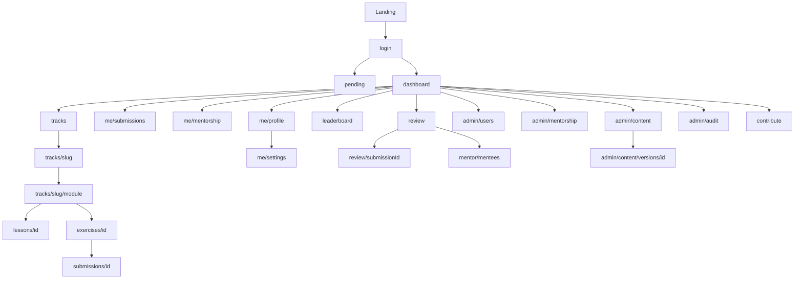

# INFORMATION-ARCHITECTURE — Kiến trúc thông tin

> Nhãn: **[MVP]**, **[P2]**. Route tương ứng ở FRONTEND-DESIGN §3.

## 1. Điều hướng chính

| Vị trí | Mục | Hiển thị cho |
| --- | --- | --- |
| Sidebar (desktop) / thanh dưới (mobile) | **Bảng điều khiển** · **Lộ trình** (tracks) · **Bài nộp của tôi** · **Mentor** · **Bảng xếp hạng** [MVP-Full] | member |
| Sidebar | **Hàng đợi review** | mentor |
| Sidebar | **Quản trị** (Người dùng, Mentoring, Nội dung, Nhật ký) | admin; mục **Nội dung** cho cả content_maintainer |
| Topbar | Tìm kiếm [P2], hộp thông báo trong app [P2], menu hồ sơ (hồ sơ, **cài đặt** — thông báo push & bảng xếp hạng [MVP-Full], theme, đăng xuất) | tất cả |
| Footer / Topbar phụ | Liên kết: Site CLB, Mentoring Program, Discord, GitHub org, Đóng góp nội dung | tất cả |

## 2. Sitemap



## 3. Dashboard (member)

Khối theo thứ tự ưu tiên:
1. **Tiếp tục học** — một thẻ lớn: bài kế tiếp (lesson/exercise) của track gần nhất. [MVP]
2. **Việc cần làm** — bài `changes_requested` cần sửa, bài đang `testing`, yêu cầu mentor đang chờ. [MVP]
3. **Lộ trình của tôi** — danh sách track đã enroll với vòng tiến độ, nhãn đợi (`cohort`). [MVP]
4. **Mentor của tôi** — tên, nút nhắn (liên kết Discord), bài đang chờ review. [MVP]
5. **Gợi ý** — track liên quan chưa enroll. [P2]
6. **Huy hiệu & streak** (tuỳ chọn, tắt được). [P2]

Dashboard mentor (trong `/review` + `/mentor/mentees`): số bài chờ, bài chờ lâu nhất, mentee có hoạt động gần đây/không hoạt động ≥ 14 ngày. [MVP]
`/review` lọc theo track và mentee qua URL (`?track=&mentee=`, giữ khi tải lại); ô lọc mentee và số "mentee không hoạt động" chỉ hiện khi mentor có mentee `active` trong `mentor_assignments` (E8). "Không hoạt động" = không nộp bài, không có tiến độ bài học trong 14 ngày, tính từ ngày bắt đầu kèm cặp.
Dashboard admin (`/admin`): số thành viên `pending`, số track published, version draft chờ publish, hàng đợi review quá hạn, số test_run lỗi 7 ngày. [MVP-Full]

## 4. Cấu trúc Learning Path (Track)

```
Track  (catalog card: tiêu đề, level, giờ ước tính, tags, số bài, người đóng góp)
 └─ Trang Track
     • Giới thiệu + "Sau khi học bạn có thể…" (outcomes)
     • Điều kiện tiên quyết (track khuyến nghị)
     • Lộ trình: danh sách Module (có % tiến độ)
     • Người duy trì / tác giả, giấy phép, Cập nhật lần cuối (sha)
     • CTA: Bắt đầu / Tiếp tục
```

## 5. Course & lesson

```
Module
 ├─ Lesson 1 … n   (đọc)
 └─ Exercise 1 … n (làm)
```
Trang **Lesson** gồm: breadcrumb (Track › Module › Lesson), mục tiêu bài, nội dung Markdown, mục lục (desktop), khối "Bài tập liên quan", điều hướng Trước/Sau, nút **Đánh dấu đã học**, liên kết "Sửa trên GitHub" [P2], dấu thời gian cập nhật.
Trang **Module**: danh sách xen kẽ lesson/exercise theo thứ tự đề xuất, trạng thái từng mục (khóa/chưa/đang/xong).

## 6. Trải nghiệm bài tập (Exercise)

Bố cục hai cột (desktop):
- **Trái:** đề bài (`statement.md`), ví dụ, tiêu chí hoàn thành, hint [P2].
- **Phải:** khung hành động theo `type`:
  - `code`: bước 1 "Tạo repo của track từ template" (nút, chỉ hiện nếu bạn chưa có repo cho track này), bước 2 "Làm bài trong thư mục `<starterPath>` và mở PR", bước 3 "Dán URL PR" → Nộp.
  - `quiz`: câu hỏi, nút Kiểm tra, kết quả + giải thích ngay.
  - `self_check`: checklist + đáp án gập + "Tôi đã hoàn thành".
  - `project`: yêu cầu + rubric + dán URL repo/PR.
- Header: tiêu đề, độ khó, thời lượng, trạng thái (`ExerciseState`), prerequisite chưa đạt (nếu khóa).

## 7. Trải nghiệm bài nộp (Submission)

`/submissions/[id]`: tiêu đề bài + lần thử (#attempt); **trạng thái dạng dòng thời gian** (Đã nộp → Đang chạy test → Kết quả → Chờ review → Duyệt/Cần sửa); khối **Kết quả test** (pass/fail, số test, thời lượng, tóm tắt, link log GitHub); khối **Review** (nhận xét tổng, các comment theo file/dòng); **Lịch sử các lần nộp** (so sánh trạng thái); nút "Nộp lại", "Chạy lại test", "Nhờ mentor review".

## 8. Mentor dashboard

- **Hàng đợi** (`/review`): bảng/thẻ; cột: mentee, bài, track, nộp lúc, thời gian chờ, kết quả test; lọc (mentee của tôi / toàn track / chưa ai nhận); nút "Nhận review".
- **Màn hình review**: 2 cột — trái: liên kết/diff PR + kết quả test + lịch sử lần nộp; phải: form review (comment theo dòng, nhận xét tổng, chọn `approved`/`changes_requested`).
- **Mentee của tôi** (`/mentor/mentees`): danh sách, tiến độ từng track, hoạt động gần nhất, ghi chú riêng của mentor [P2].
- **Yêu cầu mentoring**: danh sách `requested` để nhận/từ chối.

## 9. Admin dashboard

| Khu | Trang | Chức năng |
| --- | --- | --- |
| Người dùng | `/admin/users` | duyệt `pending`, gán vai trò, tạm khóa |
| Email được duyệt | `/admin/approved-emails` | dán/thay danh sách email thành viên (chỉ admin) |
| Mentoring | `/admin/mentorship` | gán/đổi mentor, xem giới hạn mentee |
| Nội dung | `/admin/content` | danh sách version (draft/published), nút Sync, xem diff & lỗi validate, Publish/Reject |
| Nhật ký | `/admin/audit` | tìm theo người/hành động/thời gian |
| Báo cáo [P2] | `/admin/reports` | tiến độ theo đợt/track, xuất CSV |

## 10. Trang đóng góp `/contribute` [MVP đơn giản]

Giải thích 5 bước đóng góp nội dung, liên kết tới `learning-hub-content`, hướng dẫn validate cục bộ, danh sách việc "good first content" (do maintainer gắn nhãn).

## 11. Bảng xếp hạng & cài đặt thông báo [MVP-Full]

**Bảng xếp hạng** (`/leaderboard`, DECISIONS ADR-08): bộ chọn kỳ/đợt (mặc định kỳ hiện tại) · bảng **top 10** (hạng, tên hiển thị, avatar, số bài hoàn thành có trọng số) · dòng **"Hạng của bạn"** · ghi chú cách tính (chỉ người đã opt-in, `self_check` trọng số thấp hơn, không tính tốc độ, reset mỗi kỳ). Người chưa opt-in thấy lời mời bật tại cài đặt. Không có xếp hạng toàn thời gian.

**Cài đặt** (`/me/settings`):
- **Thông báo:** công tắc Web Push cho thiết bị hiện tại; danh sách thiết bị đã bật (tên trình duyệt, lần dùng cuối, nút gỡ); sự kiện nhận: bài được review, yêu cầu review mới (mentor), track mới publish; hướng dẫn iOS "Thêm vào Màn hình chính". Discord vẫn là kênh thứ hai.
- **Bảng xếp hạng:** "Hiện tôi trên bảng xếp hạng" (mặc định tắt).
