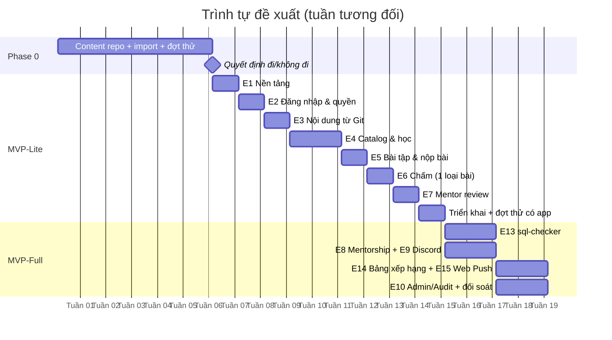

# MVP-BACKLOG

> Ưu tiên MoSCoW: **M**ust · **S**hould · **C**ould · **W**on't (cho MVP). Mức: Lite = MVP-Lite (≈ 6–8 tuần), Full = MVP-Full. Ước lượng theo "người-tuần" cho sinh viên bán thời gian (~8 giờ/tuần); chỉ mang tính định hướng.
> Phụ thuộc: `→ E2` nghĩa là cần epic E2 trước.

> **Theo dõi tiến độ:** từ 18/11/2026, việc cần làm và trạng thái nằm trên [GitHub Project](https://github.com/orgs/hcmute-dsc/projects/1) (cách dùng: [WORKFLOW](../ops/WORKFLOW.md)); field **Epic** trên board có đủ E1–E15 (E11 là option "Vận hành"). Tài liệu này giữ phần thiết kế: story, task, acceptance. Cột trạng thái bên dưới chỉ là ảnh chụp ngày 18/11/2026; khi khác nhau, tin board.

## 0. Phase 0 — xác thực nhu cầu (trước khi viết app) — **Must**

**Đã chốt (16/11/2026): chạy Phase 0.** Khung app E1–E3 đã dựng từ trước; trong Phase 0 chưa thêm tính năng app mới, chỉ làm P0-1…P0-4.

| Việc | Kết quả | Tiêu chí hoàn thành |
| --- | --- | --- |
| P0-1 Tạo `learning-hub-content`, schema, CI validate | Repo có CI chạy `hub-content-validate` (package `@hub/content` trong monorepo app) | Validate pass trên bản import mẫu — **Đã xong 16/11/2026**: [hcmute-dsc/learning-hub-content](https://github.com/hcmute-dsc/learning-hub-content), CI xanh |
| P0-2 Import SQL Challenge (script + rà soát) | Track `sql-30-days` hợp lệ | 33 bài qua validate; maintainer duyệt — **Xong**: import 16/11/2026 (4 chặng, 32 bài học, 31 bài `self_check` + dự án cuối khóa), rà soát xong 18/11/2026 ([learning-hub-content#1](https://github.com/hcmute-dsc/learning-hub-content/issues/1)), thêm quiz tổng kết; từ 18/11/2026 nằm ở repo riêng [learning-hub-track-sql-30-days](https://github.com/hcmute-dsc/learning-hub-track-sql-30-days) |
| P0-3 Chạy 1 đợt thử (4–6 tuần, ≥ 20 người) bằng app Learning Hub (track `sql-30-days`) + Discord | Số liệu & phản hồi | Báo cáo theo CRITIQUE §6 — [docs#1](https://github.com/hcmute-dsc/learning-hub-docs/issues/1); bộ công cụ chạy đợt (checklist, tin Discord, số liệu tuần, form, mẫu báo cáo): [TRIAL-P0](../ops/TRIAL-P0.md) |
| P0-4 Quyết định đi/không đi | Biên bản Ban chủ nhiệm | ≥ 3/5 tiêu chí đạt — [docs#2](https://github.com/hcmute-dsc/learning-hub-docs/issues/2); mẫu báo cáo: [TRIAL-P0 §7](../ops/TRIAL-P0.md#7-mẫu-báo-cáo-cho-p0-4) |
Nếu không đi: dừng ở content repo + site tĩnh.

## 1. Epic

| # | Epic | Phase | MoSCoW | Hiện trạng (18/11/2026) | Issue còn mở |
| --- | --- | --- | --- | --- | --- |
| E1 | Nền tảng dự án & DevEx | Lite | M | Xong phần chính: monorepo, CI (test, build, `prisma migrate`) | [#31](https://github.com/hcmute-dsc/learning-hub/issues/31) quét secret, chiều phụ thuộc, commit |
| E2 | Danh tính & quyền | Lite | M | Xong: đăng nhập GitHub, duyệt bằng danh sách email, phân quyền, khóa/mở tài khoản | — |
| E3 | Nội dung từ Git (sync/publish) | Lite | M | Xong, chạy production; từ 18/11/2026 đọc qua registry (ADR-10) | — |
| E4 | Catalog & học | Lite | M | Xong: track, enroll, bài học, tiến độ, dashboard | [#32](https://github.com/hcmute-dsc/learning-hub/issues/32) lọc theo tag |
| E5 | Bài tập & nộp bài | Lite | M | Xong cho `quiz`, `self_check`, `project` (nộp link, mentor review) | chấm tự động: E6 |
| E6 | Chấm tự động (checker repo) | Lite (1 loại bài) → Full | M | Chưa làm | [#4](https://github.com/hcmute-dsc/learning-hub/issues/4) |
| E7 | Mentor review | Lite | M | Xong phần cơ bản: hàng đợi cũ nhất trước, nhận xét, kết quả | [#30](https://github.com/hcmute-dsc/learning-hub/issues/30) lọc và số liệu |
| E8 | Mentorship (ghép cặp) | Full | S | Chưa làm | [#7](https://github.com/hcmute-dsc/learning-hub/issues/7) |
| E9 | Thông báo Discord | Full (webhook đơn giản ở Lite) | S | Xong: webhook kênh CLB và kênh vận hành, outbox | — |
| E10 | Quản trị & audit | Full | S | Một phần: thành viên, email được duyệt, nội dung, nhật ký | [#29](https://github.com/hcmute-dsc/learning-hub/issues/29) tổng quan, [#34](https://github.com/hcmute-dsc/learning-hub/issues/34) báo cáo/CSV |
| E11 | Vận hành & bàn giao | Lite → Full | M | Đang chạy: deploy tự động, sao lưu hằng ngày, uptime, tài liệu bàn giao | [#1](https://github.com/hcmute-dsc/learning-hub/issues/1) sao lưu ra ngoài, [#28](https://github.com/hcmute-dsc/learning-hub/issues/28) `/contribute` |
| E12 | Phase 2 (hint, huy hiệu, notification in-app/email, Google, chứng nhận hoàn thành track, v.v.) | P2 | W (MVP) | Chưa làm | [#33](https://github.com/hcmute-dsc/learning-hub/issues/33), [#35](https://github.com/hcmute-dsc/learning-hub/issues/35) |
| E13 | Chấm SQL trên VPS (`sql-checker`, "B-lite" — ADR-07) | Full (ngay sau MVP-Lite) | M | Chưa làm | [#3](https://github.com/hcmute-dsc/learning-hub/issues/3) |
| E14 | Bảng xếp hạng opt-in theo học kỳ (ADR-08) | Full | M | Chưa làm | [#5](https://github.com/hcmute-dsc/learning-hub/issues/5) |
| E15 | Thông báo Web Push (ADR-08) | Full | M | Chưa làm | [#6](https://github.com/hcmute-dsc/learning-hub/issues/6) |

## 2. Chi tiết

### E1 — Nền tảng & DevEx (M)
| Story | Task | Acceptance | Phụ thuộc |
| --- | --- | --- | --- |
| Là dev, tôi chạy được dự án trong 30 phút | Khởi tạo monorepo pnpm, `apps/api`, `apps/web`, `packages/shared`; docker-compose (postgres); `.env.example`; seed | `pnpm i && docker compose up -d && pnpm dev` chạy; README onboarding | — |
| Là dev, tôi muốn CI bảo vệ chất lượng | GitHub Actions: lint, typecheck, test, build, `prisma migrate` trên DB trống, gitleaks, boundaries lint | PR đỏ nếu fail; thời gian < 8 phút | E1 |
| Là dev, tôi muốn chuẩn code | ESLint, Prettier, commitlint, Husky; pino, Zod env | Pre-commit chạy được | E1 |

### E2 — Danh tính & quyền (M) → E1
| Story | Task | Acceptance | Trạng thái |
| --- | --- | --- | --- |
| US-01 Đăng nhập GitHub | OAuth + PKCE, tạo user, session DB, cookie | Đăng nhập/đăng xuất; user `pending` thấy `/pending` | Đã có (khung E1–E3) |
| Phân quyền | Bảng `roles`, `user_roles`, guard + policy, seed admin | Ma trận quyền có test e2e | Đã có (khung E1–E3) |
| Duyệt thành viên | Admin/mentor duyệt `pending` (UI tối giản hoặc SQL runbook ở Lite) | Chuyển `active` + audit | Đã có (khung E1–E3) |
| Duyệt bằng danh sách email (quyết định 16/11/2026) | Bảng `approved_emails` + migration; lúc đăng nhập gọi `GET /user/emails` (scope `user:email`), khớp mọi email đã xác minh → `active`, user `pending` khớp ở lần sau cũng `active`; `GET/PUT /admin/approved-emails` (chỉ admin; Lite: form dán danh sách tối giản); bỏ org/allowlist login khỏi quy tắc tự duyệt (org chỉ là tùy chọn); giữ `BOOTSTRAP_ADMIN_GITHUB_LOGIN` | Email phụ đã xác minh khớp → `active`; email chưa xác minh không khớp; thay đổi danh sách ghi audit (không chép danh sách); member/mentor không đọc được danh sách | Đã có |

### E3 — Nội dung từ Git (M) → E2
| Story | Task | Acceptance | Trạng thái |
| --- | --- | --- | --- |
| Validator | Package `@hub/content` (Zod schema, parser, CLI `hub-content-validate`); `content-example` cho dev/test | Lỗi nêu file; exit 1 khi có lỗi | Đã có |
| US-09/10 Sync & publish | `ContentSource` + `LocalDirContentSource`/`GithubContentSource`; bảng `content_versions`; sync = validate + ghi version `draft`/`rejected` (không ghi catalog); publish = đọc lại tại SHA, validate lại, upsert catalog trong 1 giao dịch; endpoint sync/publish + CLI `pnpm --filter @hub/api content:sync [--sha <sha>] [--publish]` ở Lite, UI admin ở Full | Version `draft` có `commit_sha` + diff; sync lại cùng commit không tạo version mới; publish đúng 1 version; item bị gỡ → `archived`; lỗi validate nêu file (422) | Đã có; từ 18/11/2026 thêm `RegistryContentSource` (ADR-10) |
| Seed không còn track demo | Nội dung demo local từ sync `content-example` | Seed chỉ tạo roles/admin | Đã có |
| Import SQL | Dùng script P0-2 | Track SQL hiển thị trong DB | Đã làm (sync + publish từ GitHub, 16/11/2026) |

### E4 — Catalog & học (M) → E3
| Story | Task | Acceptance |
| --- | --- | --- |
| US-02 Xem track | API + trang `/tracks`, `/tracks/[slug]` | Chỉ published; lọc level/tag |
| US-03 Enroll | `enrollments` idempotent + `cohort` | Enroll 2 lần không trùng |
| US-04 Học lesson | Trang lesson (Markdown sanitize), `lesson_progress`, điều hướng | Đánh dấu xong; mục lục |
| Dashboard | "Tiếp tục học", tiến độ track | Hiển thị đúng % |

### E5 — Bài tập & nộp bài (M) → E4
| Story | Task | Acceptance |
| --- | --- | --- |
| `quiz` | Chấm trong app, không lộ đáp án xuống client | Kết quả + giải thích |
| `self_check` | Checklist + đánh dấu hoàn thành | Tính vào tiến độ |
| Prerequisite | `UnlockPolicy` + UI khóa | Bài khóa nêu lý do |
| US-05 Nộp bài | `submissions` (attempt, idempotency), validate URL, lịch sử lần nộp | Nộp lại tạo submission mới |

### E6 — Chấm tự động (M cho 1 loại; S cho mở rộng) → E5
| Story | Task | Acceptance |
| --- | --- | --- |
| GitHub App + webhook | Tạo App, adapter, xác thực HMAC, `webhook_deliveries` | Giao hàng trùng không tạo bản ghi trùng |
| Checker repo | Tạo `learning-hub-checker` (riêng tư), workflow `check-exercise.yml`, 1 bài mẫu (SQL hoặc Git) | Thành viên không sửa được kết quả (kiểm thử đối kháng: PR cố sửa workflow) |
| TestRun | Ghi `test_runs`, cập nhật trạng thái, hiển thị | Kết quả ≤ 3 phút |
| Đối soát | Job `reconcile-test-runs` (Full) | Run lỡ webhook vẫn có kết quả |

### E7 — Mentor review (M) → E6
| Story | Task | Acceptance |
| --- | --- | --- |
| US-07 Hàng đợi | `/review` lọc/sắp xếp | Cũ nhất trước |
| US-08 Review | `reviews`, `review_comments`, complete → cập nhật trạng thái, chống tự review | Tối đa 1 review mở/submission |
| Hiển thị cho member | Trang submission hiện review | Thấy nhận xét theo dòng |

### E8 — Mentorship (S) → E2
| Story | Task | Acceptance |
| --- | --- | --- |
| US-06 Xin mentor | `mentor_assignments`, form, trạng thái | 1 yêu cầu mở/track |
| US-11 Gán/đổi | Admin UI, giới hạn mentee/mentor qua cấu hình `MENTOR_MAX_MENTEES` (chốt theo học kỳ) | Lịch sử giữ |
| Danh sách mentee | `/mentor/mentees` | Tiến độ từng mentee |

### E9 — Thông báo Discord (S) → E7
| Story | Task | Acceptance |
| --- | --- | --- |
| Gửi webhook | `NotificationChannel` + adapter; sự kiện: cần review, review xong, version published | Lỗi Discord không làm hỏng request (Lite: log; Full: `outbox_events` + retry) |

### E13 — Chấm SQL trên VPS (`sql-checker`) (M, Full — làm ngay sau MVP-Lite) → E5, E6, E11
Quyết định 16/11/2026 (DECISIONS ADR-07): phần lớn nội dung là SQL; 31 bài `self_check` của `sql-30-days` có thể chuyển sang chấm tự động. Thiết kế: ARCHITECTURE §7 (sql-checker), SECURITY §7.

| Story | Task | Acceptance | Trạng thái |
| --- | --- | --- | --- |
| Service `sql-checker` | Container riêng (đề xuất `apps/sql-checker`) + PostgreSQL riêng nạp dataset DSC Shop; mạng Docker riêng chỉ `api` gọi được; không đường ra Internet; giới hạn CPU/bộ nhớ | `sql-checker` không kết nối được DB hub; không publish port; compose prod/local chạy được | Chưa làm |
| Sandbox truy vấn | Role ít quyền (không superuser), `BEGIN READ ONLY … ROLLBACK` (schema/database dùng một lần cho bài sửa dữ liệu), `statement_timeout` 2–5 s, `idle_in_transaction_session_timeout`, giới hạn dòng/kích thước; cấm `COPY … PROGRAM`, `dblink`, extension untrusted | Bộ kiểm thử đối kháng (ghi dữ liệu, `pg_sleep`, `COPY … PROGRAM`, nhiều câu lệnh, `SET ROLE`) đều bị chặn | Chưa làm |
| So sánh kết quả | So với tập kết quả kỳ vọng từ `learning-hub-checker` (riêng tư); có thứ tự khi đề yêu cầu `ORDER BY`; trả diff tóm tắt | Lời giải không lộ ra member; kết quả ≤ 5 s | Chưa làm |
| Loại bài & nộp | Quyết định spec khi cài đặt (nghiêng về `code` + `runtime.language: sql` + `checker.kind: sql`); `submissions.source_type = sql_query`; port `SqlChecker` + adapter; ghi `test_runs` (`provider = sql_checker`) | Nộp truy vấn trong app → `passed`/`failed` hiển thị như bài `code` | Chưa làm |
| Chuyển đổi nội dung | Chuyển dần bài `self_check` của `sql-30-days` sang chấm tự động (PR vào content repo + kết quả kỳ vọng vào checker repo) | ≥ 10 bài chuyển xong trong đợt đầu | Chưa làm |

### E14 — Bảng xếp hạng opt-in (M, Full) → E5, E6
| Story | Task | Acceptance | Trạng thái |
| --- | --- | --- | --- |
| Opt-in | Cột `users.leaderboard_opt_in` (mặc định `false`); bật/tắt trong cài đặt hồ sơ | Chưa bật thì không xuất hiện; tắt là biến mất ngay | Chưa làm |
| Bảng xếp hạng theo kỳ | View/truy vấn `v_leaderboard_term` (không lưu điểm): đếm bài hoàn thành trong kỳ (`approved` hoặc tự động `passed`), `self_check` trọng số thấp hơn; lọc theo kỳ/đợt (`cohort`); trang `/leaderboard` | Top 10 + hạng của người xem; không theo tốc độ; không có xếp hạng toàn thời gian; sang kỳ mới tự reset | Chưa làm |

### E15 — Thông báo Web Push (M, Full) → E9
| Story | Task | Acceptance | Trạng thái |
| --- | --- | --- | --- |
| Đăng ký thiết bị | Service worker + web app manifest; bảng `push_subscriptions`; endpoint đăng ký/hủy; trang cài đặt thông báo; hướng dẫn iOS "Thêm vào Màn hình chính" | Bật/tắt theo thiết bị; `endpoint` ngoài danh sách push service bị từ chối | Chưa làm |
| Gửi thông báo | Khóa VAPID (P-256) trong secret; adapter `WebPushChannel` qua `outbox_events`; sự kiện: bài được review, yêu cầu review mới (mentor), track mới publish | Subscription 404/410 tự xóa; lỗi push không làm hỏng request; Discord vẫn gửi song song | Chưa làm |

### E10 — Quản trị & audit (S) → E2, E3
| Story | Task | Acceptance |
| --- | --- | --- |
| Admin users/roles UI | Trang `/admin/users` | Gán vai trò + audit |
| Audit | Listener ghi `audit_logs`, trang xem | Append-only |
| Dashboard admin | Số liệu cơ bản | Theo IA §9 |

### E11 — Vận hành & bàn giao (M) → E1
| Story | Task | Acceptance |
| --- | --- | --- |
| Triển khai | Dockerfile api/web, compose prod trên 1 VPS (được tài trợ), Caddy, deploy workflow, backup `pg_dump` + thử khôi phục | Deploy bằng 1 nút; restore thử thành công |
| Runbook bàn giao | Danh sách **mọi** tài khoản/secret (GitHub App/OAuth app, domain, VPS, Discord webhook, …) theo **chức danh**, không chứa giá trị; người giữ hiện tại: Chủ nhiệm CLB (GitHub `TienNHM`, tài trợ VPS); quy trình chuyển quyền sở hữu cho Chủ nhiệm kế tiếp; xử lý sự cố | Người mới làm theo được trong 1 buổi; checklist chuyển chủ sở hữu đủ mọi mục |
| Giám sát | Health check, cảnh báo Discord | Có cảnh báo khi 5xx |
| Đóng góp | `/contribute`, `CONTRIBUTING.md` hai repo | PR đầu tiên từ người ngoài Ban |

## 3. MoSCoW tổng

| M (bắt buộc) | S (nên có) | C (có thể) | W (không ở MVP) |
| --- | --- | --- | --- |
| E1, E2, E3, E4, E5, E6 (1 loại bài), E7, E11; Full: E13, E14, E15 | E8, E9, E10, đối soát test | Tìm kiếm Postgres FTS, xuất CSV, dark mode tinh chỉnh | Online judge/runner nhiều ngôn ngữ (Judge0/Piston), bot Discord, huy hiệu, hint/solution, notification in-app, Google OAuth, upload, Redis/BullMQ, cohort đầy đủ, i18n en |

## 4. Trình tự thực hiện (đề xuất)

MVP-Full chạy hai nhánh song song (E13 ‖ E8/E9 → E14/E15) để giữ ≈ 4–6 tuần. Sau MVP-Full, Phase 2 gồm **chứng nhận hoàn thành track** do hub cấp (PRD F19; không quy đổi điểm rèn luyện). Ngày chỉ minh họa; Ban chủ nhiệm đặt lịch thật theo học kỳ. Nên phát hành nội bộ cho một nhóm nhỏ ở cuối MVP-Lite và nhận phản hồi trước khi làm Full.

## 5. Ước lượng & đội hình khuyến nghị

- 1 tech lead (hiện tại: TienNHM; người kế nhiệm cần chỉ định trước kỳ đổi Ban chủ nhiệm hằng năm), 2 backend, 2 frontend/nội dung, 1 người phụ trách content + mentor liaison (không bắt buộc là dev).
- Quy tắc: mỗi module có **2 người** hiểu (chống bus factor); mỗi PR có review; 1 buổi demo/2 tuần.
- Rủi ro lịch: ngày thi/học kỳ — dự trữ 30% thời gian dự phòng.

## 6. Definition of Done

Code + test (unit/e2e theo rủi ro) + migration + cập nhật OpenAPI/tài liệu + chạy CI xanh + review ≥ 1 người + demo được + không vi phạm ranh giới module + không secret trong repo.
