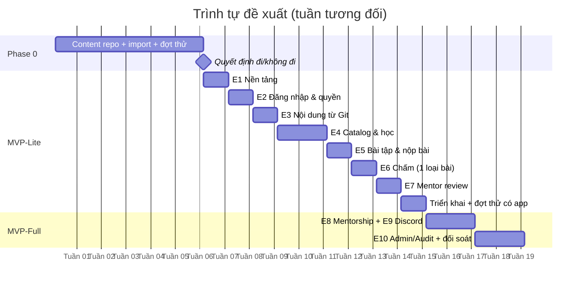

# MVP-BACKLOG

> Ưu tiên MoSCoW: **M**ust · **S**hould · **C**ould · **W**on't (cho MVP). Mức: Lite = MVP-Lite (≈ 6–8 tuần), Full = MVP-Full. Ước lượng theo "người-tuần" cho sinh viên bán thời gian (~8 giờ/tuần); chỉ mang tính định hướng.
> Phụ thuộc: `→ E2` nghĩa là cần epic E2 trước.

## 0. Phase 0 — xác thực nhu cầu (trước khi viết app) — **Must**

**Đã chốt (16/11/2026): chạy Phase 0.** Khung app E1–E3 đã dựng từ trước; trong Phase 0 chưa thêm tính năng app mới, chỉ làm P0-1…P0-4.

| Việc | Kết quả | Tiêu chí hoàn thành |
| --- | --- | --- |
| P0-1 Tạo `learning-hub-content`, schema, CI validate | Repo có CI chạy `hub-content-validate` (package `@hub/content` trong monorepo app) | Validate pass trên bản import mẫu — **Đã xong 16/11/2026**: [hcmute-dsc/learning-hub-content](https://github.com/hcmute-dsc/learning-hub-content), CI xanh |
| P0-2 Import SQL Challenge (script + rà soát) | Track `sql-30-days` hợp lệ | 33 bài qua validate; maintainer duyệt — **Đã import 16/11/2026**: 4 chặng, 32 bài học, 31 bài `self_check` + dự án cuối khóa (`project`, rubric 100 điểm), bằng `tools/import-sql-challenge.mjs`; còn chờ maintainer rà soát nội dung |
| P0-3 Chạy 1 đợt thử (4–6 tuần, ≥ 20 người) bằng site VitePress + PR/Issue + Discord | Số liệu & phản hồi | Báo cáo theo CRITIQUE §6 |
| P0-4 Quyết định đi/không đi | Biên bản Ban chủ nhiệm | ≥ 3/5 tiêu chí đạt |
Nếu không đi: dừng ở content repo + site tĩnh.

## 1. Epic

| # | Epic | Phase | MoSCoW |
| --- | --- | --- | --- |
| E1 | Nền tảng dự án & DevEx | Lite | M |
| E2 | Danh tính & quyền | Lite | M |
| E3 | Nội dung từ Git (sync/publish) | Lite | M |
| E4 | Catalog & học | Lite | M |
| E5 | Bài tập & nộp bài | Lite | M |
| E6 | Chấm tự động (checker repo) | Lite (1 loại bài) → Full | M |
| E7 | Mentor review | Lite | M |
| E8 | Mentorship (ghép cặp) | Full | S |
| E9 | Thông báo Discord | Full (webhook đơn giản ở Lite) | S |
| E10 | Quản trị & audit | Full | S |
| E11 | Vận hành & bàn giao | Lite → Full | M |
| E12 | Phase 2 (hint, huy hiệu, notification, Google, chứng nhận hoàn thành track, v.v.) | P2 | W (MVP) |

## 2. Chi tiết

### E1 — Nền tảng & DevEx (M)
| Story | Task | Acceptance | Phụ thuộc |
| --- | --- | --- | --- |
| Là dev, tôi chạy được dự án trong 30 phút | Khởi tạo monorepo pnpm, `apps/api`, `apps/web`, `packages/shared`; docker-compose (postgres); `.env.example`; seed | `pnpm i && docker compose up -d && pnpm dev` chạy; README onboarding | — |
| Là dev, tôi muốn CI bảo vệ chất lượng | GitHub Actions: lint, typecheck, test, build, `prisma migrate` trên DB trống, gitleaks, boundaries lint | PR đỏ nếu fail; thời gian < 8 phút | E1 |
| Là dev, tôi muốn chuẩn code | ESLint, Prettier, commitlint, Husky; pino, Zod env | Pre-commit chạy được | E1 |

### E2 — Danh tính & quyền (M) → E1
| Story | Task | Acceptance | Trạng thái |
| --- | --- | --- | --- |
| US-01 Đăng nhập GitHub | OAuth + PKCE, tạo user, session DB, cookie | Đăng nhập/đăng xuất; user `pending` thấy `/pending` | Đã có (khung E1–E3) |
| Phân quyền | Bảng `roles`, `user_roles`, guard + policy, seed admin | Ma trận quyền có test e2e | Đã có (khung E1–E3) |
| Duyệt thành viên | Admin/mentor duyệt `pending` (UI tối giản hoặc SQL runbook ở Lite) | Chuyển `active` + audit | Đã có (khung E1–E3) |
| Duyệt bằng danh sách email (quyết định 16/11/2026) | Bảng `approved_emails` + migration; lúc đăng nhập gọi `GET /user/emails` (scope `user:email`), khớp mọi email đã xác minh → `active`, user `pending` khớp ở lần sau cũng `active`; `GET/PUT /admin/approved-emails` (chỉ admin; Lite: form dán danh sách tối giản); bỏ org/allowlist login khỏi quy tắc tự duyệt (org chỉ là tùy chọn); giữ `BOOTSTRAP_ADMIN_GITHUB_LOGIN` | Email phụ đã xác minh khớp → `active`; email chưa xác minh không khớp; thay đổi danh sách ghi audit (không chép danh sách); member/mentor không đọc được danh sách | Chưa làm |

### E3 — Nội dung từ Git (M) → E2 — **đang làm**
| Story | Task | Acceptance | Trạng thái |
| --- | --- | --- | --- |
| Validator | Package `@hub/content` (Zod schema, parser, CLI `hub-content-validate`); `content-example` cho dev/test | Lỗi nêu file; exit 1 khi có lỗi | Đang làm |
| US-09/10 Sync & publish | `ContentSource` + `LocalDirContentSource`/`GithubContentSource`; bảng `content_versions`; sync = validate + ghi version `draft`/`rejected` (không ghi catalog); publish = đọc lại tại SHA, validate lại, upsert catalog trong 1 giao dịch; endpoint sync/publish + CLI `pnpm --filter @hub/api content:sync [--sha <sha>] [--publish]` ở Lite, UI admin ở Full | Version `draft` có `commit_sha` + diff; sync lại cùng commit không tạo version mới; publish đúng 1 version; item bị gỡ → `archived`; lỗi validate nêu file (422) | Đang làm |
| Seed không còn track demo | Nội dung demo local từ sync `content-example` | Seed chỉ tạo roles/admin | Đang làm |
| Import SQL | Dùng script P0-2 | Track SQL hiển thị trong DB | Đã làm (sync + publish từ GitHub, 16/11/2026) |

### E4 — Catalog & học (M) → E3
| Story | Task | Acceptance |
| --- | --- | --- |
| US-02 Xem track | API + trang `/tracks`, `/tracks/[slug]` | Chỉ published; lọc level/tag |
| US-03 Enroll | `enrollments` idempotent + `cohort` | Enroll 2 lần không trùng |
| US-04 Học lesson | Trang lesson (Markdown sanitize), `lesson_progress`, điều hướng | Đánh dấu xong; mục lục |
| Dashboard | "Tiếp tục học", tiến độ track | Hiển thị đúng % |

### E5 — Bài tập & nộp bài (M) → E4
| Story | Task | Acceptance |
| --- | --- | --- |
| `quiz` | Chấm trong app, không lộ đáp án xuống client | Kết quả + giải thích |
| `self_check` | Checklist + đánh dấu hoàn thành | Tính vào tiến độ |
| Prerequisite | `UnlockPolicy` + UI khóa | Bài khóa nêu lý do |
| US-05 Nộp bài | `submissions` (attempt, idempotency), validate URL, lịch sử lần nộp | Nộp lại tạo submission mới |

### E6 — Chấm tự động (M cho 1 loại; S cho mở rộng) → E5
| Story | Task | Acceptance |
| --- | --- | --- |
| GitHub App + webhook | Tạo App, adapter, xác thực HMAC, `webhook_deliveries` | Giao hàng trùng không tạo bản ghi trùng |
| Checker repo | Tạo `learning-hub-checker` (riêng tư), workflow `check-exercise.yml`, 1 bài mẫu (SQL hoặc Git) | Thành viên không sửa được kết quả (kiểm thử đối kháng: PR cố sửa workflow) |
| TestRun | Ghi `test_runs`, cập nhật trạng thái, hiển thị | Kết quả ≤ 3 phút |
| Đối soát | Job `reconcile-test-runs` (Full) | Run lỡ webhook vẫn có kết quả |

### E7 — Mentor review (M) → E6
| Story | Task | Acceptance |
| --- | --- | --- |
| US-07 Hàng đợi | `/review` lọc/sắp xếp | Cũ nhất trước |
| US-08 Review | `reviews`, `review_comments`, complete → cập nhật trạng thái, chống tự review | Tối đa 1 review mở/submission |
| Hiển thị cho member | Trang submission hiện review | Thấy nhận xét theo dòng |

### E8 — Mentorship (S) → E2
| Story | Task | Acceptance |
| --- | --- | --- |
| US-06 Xin mentor | `mentor_assignments`, form, trạng thái | 1 yêu cầu mở/track |
| US-11 Gán/đổi | Admin UI, giới hạn mentee/mentor qua cấu hình `MENTOR_MAX_MENTEES` (chốt theo học kỳ) | Lịch sử giữ |
| Danh sách mentee | `/mentor/mentees` | Tiến độ từng mentee |

### E9 — Thông báo Discord (S) → E7
| Story | Task | Acceptance |
| --- | --- | --- |
| Gửi webhook | `NotificationChannel` + adapter; sự kiện: cần review, review xong, version published | Lỗi Discord không làm hỏng request (Lite: log; Full: `outbox_events` + retry) |

### E10 — Quản trị & audit (S) → E2, E3
| Story | Task | Acceptance |
| --- | --- | --- |
| Admin users/roles UI | Trang `/admin/users` | Gán vai trò + audit |
| Audit | Listener ghi `audit_logs`, trang xem | Append-only |
| Dashboard admin | Số liệu cơ bản | Theo IA §9 |

### E11 — Vận hành & bàn giao (M) → E1
| Story | Task | Acceptance |
| --- | --- | --- |
| Triển khai | Dockerfile api/web, compose prod trên 1 VPS (được tài trợ), Caddy, deploy workflow, backup `pg_dump` + thử khôi phục | Deploy bằng 1 nút; restore thử thành công |
| Runbook bàn giao | Danh sách **mọi** tài khoản/secret (GitHub App/OAuth app, domain, VPS, Discord webhook, …) theo **chức danh**, không chứa giá trị; người giữ hiện tại: Chủ nhiệm CLB (GitHub `TienNHM`, tài trợ VPS); quy trình chuyển quyền sở hữu cho Chủ nhiệm kế tiếp; xử lý sự cố | Người mới làm theo được trong 1 buổi; checklist chuyển chủ sở hữu đủ mọi mục |
| Giám sát | Health check, cảnh báo Discord | Có cảnh báo khi 5xx |
| Đóng góp | `/contribute`, `CONTRIBUTING.md` hai repo | PR đầu tiên từ người ngoài Ban |

## 3. MoSCoW tổng

| M (bắt buộc) | S (nên có) | C (có thể) | W (không ở MVP) |
| --- | --- | --- | --- |
| E1, E2, E3, E4, E5, E6 (1 loại bài), E7, E11 | E8, E9, E10, đối soát test | Tìm kiếm Postgres FTS, xuất CSV, dark mode tinh chỉnh | Online judge/runner, bot Discord, huy hiệu, hint/solution, notification in-app, Google OAuth, upload, Redis/BullMQ, cohort đầy đủ, i18n en |

## 4. Trình tự thực hiện (đề xuất)

Sau MVP-Full, Phase 2 gồm **chứng nhận hoàn thành track** do hub cấp (PRD F19; không quy đổi điểm rèn luyện). Ngày chỉ minh họa; Ban chủ nhiệm đặt lịch thật theo học kỳ. Nên phát hành nội bộ cho một nhóm nhỏ ở cuối MVP-Lite và nhận phản hồi trước khi làm Full.

## 5. Ước lượng & đội hình khuyến nghị

- 1 tech lead (kế nhiệm được chỉ định sớm), 2 backend, 2 frontend/nội dung, 1 người phụ trách content + mentor liaison (không bắt buộc là dev).
- Quy tắc: mỗi module có **2 người** hiểu (chống bus factor); mỗi PR có review; 1 buổi demo/2 tuần.
- Rủi ro lịch: ngày thi/học kỳ — dự trữ 30% thời gian dự phòng.

## 6. Definition of Done

Code + test (unit/e2e theo rủi ro) + migration + cập nhật OpenAPI/tài liệu + chạy CI xanh + review ≥ 1 người + demo được + không vi phạm ranh giới module + không secret trong repo.
