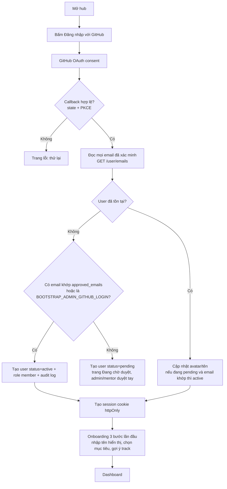
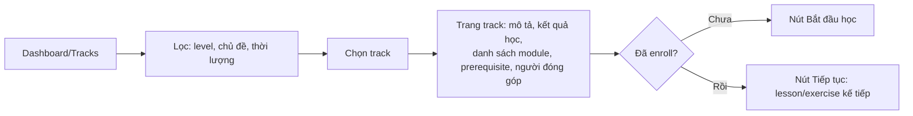
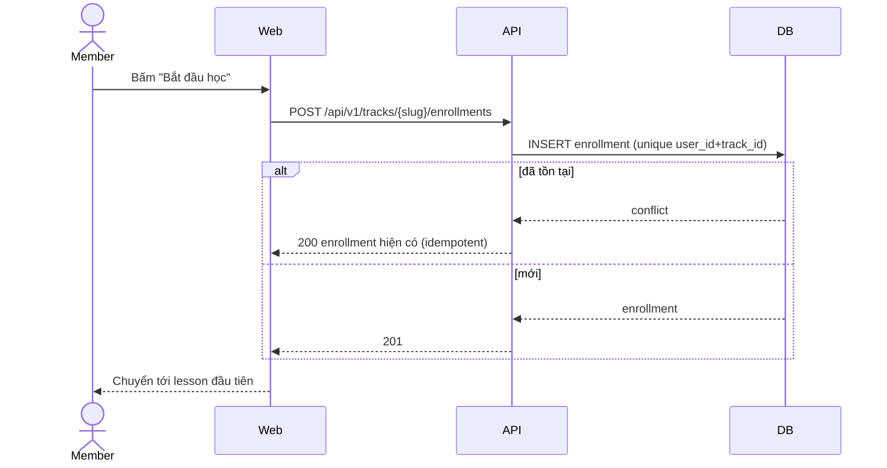
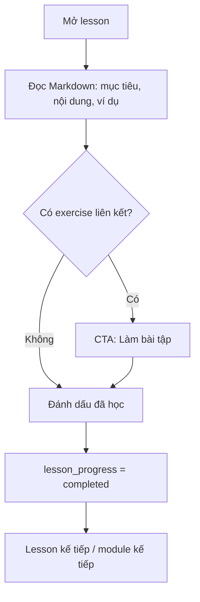
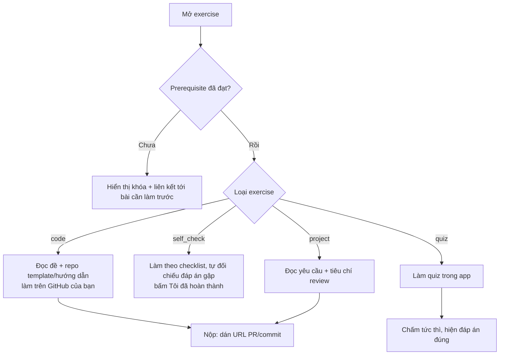
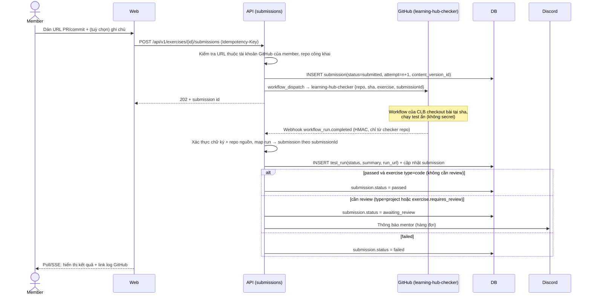
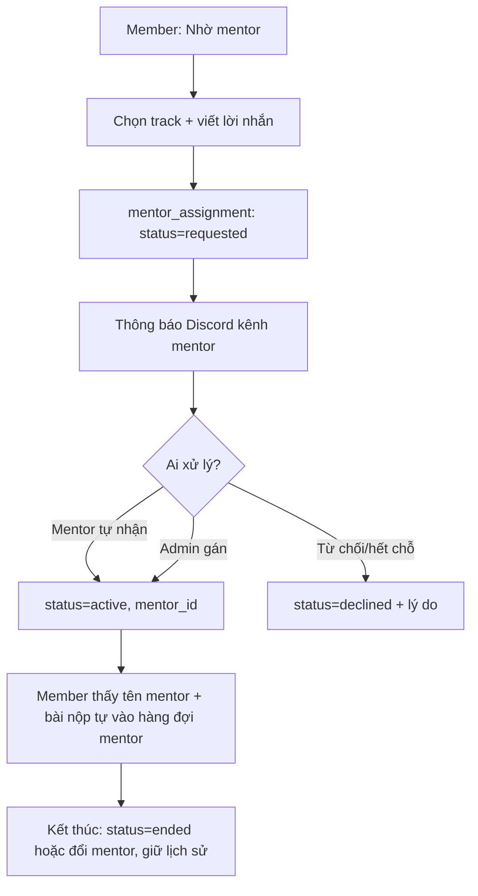
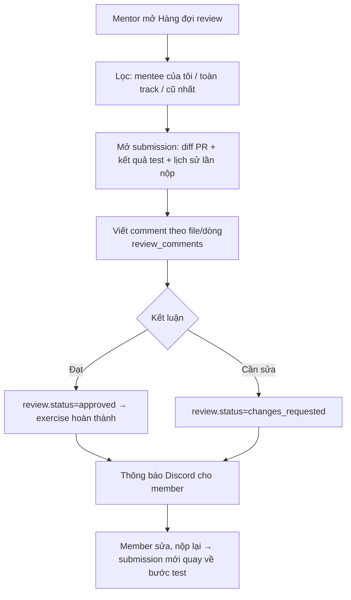
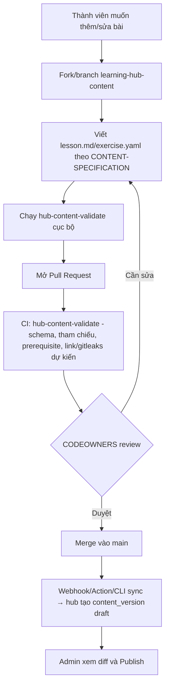
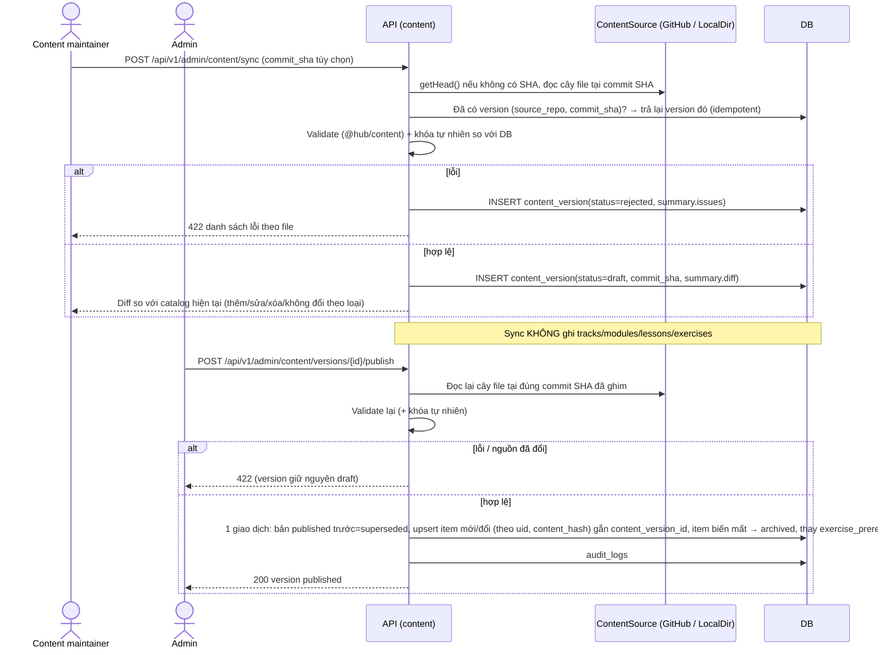

# USER-FLOWS — Hành trình người dùng

> Thuật ngữ khớp DATABASE.md: `track` > `module` > `lesson` / `exercise`; `submission`, `test_run`, `review`, `mentor_assignment`, `content_version`.
> Nhãn: **[MVP]**, **[P2]**.

## 1. Đăng ký & đăng nhập [MVP]

Không có form đăng ký riêng: lần đăng nhập GitHub đầu tiên tạo tài khoản nếu hợp lệ. Duyệt bằng **danh sách email** của CLB (đã chốt 16/11/2026): API đọc mọi email đã xác minh trên GitHub (`GET /user/emails`, cả email phụ) và so với `approved_emails`. Kiểm tra org `hcmute-dsc` chỉ là tùy chọn bổ sung, không nằm trong luồng mặc định.

## 2. Khám phá learning path [MVP]

## 3. Enroll vào track [MVP]

## 4. Học lesson [MVP]

Lesson không bắt buộc hoàn thành để làm exercise, trừ khi `prerequisites` khai báo.

## 5. Làm bài tập [MVP]

## 6. Nộp bài & phản hồi tự động [MVP]

Trạng thái submission: `submitted → testing → passed | failed → awaiting_review → approved | changes_requested`. Nộp lại = submission mới, không sửa submission cũ.

## 7. Xin mentor [MVP]

## 8. Mentor review [MVP]

**Đã chốt (16/11/2026):** kết luận review (`approved` / `changes_requested`) luôn ghi ở hub (`reviews`); thảo luận chi tiết làm được ở cả hub (`review_comments`) và GitHub (comment PR), hub lưu liên kết tới PR. Thời gian review mục tiêu cấu hình theo học kỳ (`REVIEW_TARGET_HOURS`, mặc định 72 giờ).

## 9. Đóng góp nội dung [MVP]

Phase 2: nút "Sửa trên GitHub" trên mỗi lesson, preview PR.

## 10. Admin publish learning path [MVP]

Hai bước tách biệt: **sync** chỉ đọc + validate + ghi một `content_version` (không đụng catalog); **publish** mới ghi catalog.

- **Sync** idempotent theo `(source_repo, commit_sha)`: sync lại cùng commit trả về version đã có, không tạo bản ghi mới.
- **`rejected`** = sync gặp lỗi validate; `summary` giữ danh sách lỗi để maintainer sửa trong PR mới (commit mới ⇒ version mới).
- **Publish** chỉ upsert item mới/đổi (so `content_hash`), không bao giờ xóa cứng: item không còn trong Git chuyển `archived`. Kiểm tra khóa tự nhiên chặn trường hợp `uid` bị đổi (item "mới" trùng cha + slug, hoặc track slug, của bản ghi có `id` khác).
- MVP-Lite chưa có UI admin: maintainer chạy `pnpm --filter @hub/api content:sync [--sha <sha>] [--publish]` (cùng service với endpoint). UI xem diff/publish ở MVP-Full.

Bài đã nộp giữ `content_version_id` lúc nộp, nên đổi đề sau đó không làm hỏng lịch sử.

## 11. Luồng lỗi & biên (tóm tắt)

| Tình huống | Hành vi |
| --- | --- |
| Webhook GitHub không tới | Job đối soát mỗi 5 phút (cron trong API) gọi GitHub API đọc workflow run của `learning-hub-checker` theo `submissionId`; sau 15 phút quá hạn → `test_run.status = errored`, member có nút "Chạy lại". |
| Repo của member là private hoặc đã bị xóa | Báo lỗi rõ khi nộp: bài `code` yêu cầu repo công khai (hướng dẫn đổi visibility). |
| Tài khoản GitHub mới đăng nhập, chưa được duyệt | Trạng thái `pending`: thấy trang "đang chờ duyệt", không vào catalog; Ban/mentor duyệt trong trang admin. |
| Content publish làm bài đang làm dở bị xóa | Exercise bị gỡ giữ lại ở trạng thái `archived` đối với người đã nộp; không xóa cứng. |
| Mentor nghỉ | Admin chuyển mentee sang mentor khác; assignment cũ `ended`. |
